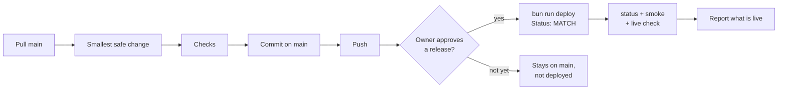

# Contributing to PadhAI

PadhAI is proprietary software of Networkers Home ([LICENSE.md](LICENSE.md)). Contributions come from people the
owner has given access to.

This page is the human workflow. The rules it follows are in [CLAUDE.md](CLAUDE.md), and those apply to people and
AI agents alike:
- the architecture guardrail;
- the owner's hard rules for production, testing and release.

Where this page and CLAUDE.md differ, CLAUDE.md wins.

## Before your first change

1. Read [docs/start-here.md](docs/start-here.md) and [CLAUDE.md](CLAUDE.md).
2. Set the project up: [docs/beginner-guide.md](docs/beginner-guide.md) (or, in short,
   [docs/development.md](docs/development.md)).
3. Find your way around: [docs/codebase-map.md](docs/codebase-map.md).

## The workflow

1. **Start from the latest `main`:** `git pull origin main`. Several people and agents commit to the same `main`.
2. **Make the smallest safe change** that does the job:
   - reuse what exists;
   - add no dependencies, services or abstractions unless they're needed;
   - don't refactor working code on the side.

   Building a feature end to end is described in [docs/adding-a-feature.md](docs/adding-a-feature.md).
3. **Run the checks for what you changed** (the owner's rules):
   - **API:** `ruff check` and `ruff format --check` (both are in `bun run lint`), plus an import check;
   - **web app:** `bun run typecheck`, `bun run lint`, `bun run test` and `bun run build`, from `frontend/`;
   - **deploy scripts:** `bun test deploy/tests`;
   - **an API route or schema:** `bun run contract`, and commit the regenerated `docs/openapi.json` and
     `contract.gen.ts`.

   A failing check is fixed, never committed.
4. **Commit on `main`.** There are no pull requests and no feature branches.
   - Write the message as the repository does: the area, then what changed for the user. For example,
     `Voice mode: only the tutor on screen; a 0.6 s pause ends the question`.
   - One commit is one release of both halves, so keep a commit to one change.
5. **Push:** `git push origin main`. Never force-push. If the push is refused because `main` moved, pull, check
   again, and push.
6. **Release only with the owner's approval:**
   - run `bun run deploy`, which must end with `Status: MATCH`;
   - then `bun run status`, then `bun run smoke` (every check PASS), then check what you changed on the live site.

   The details are in [docs/deployment.md](docs/deployment.md).
7. **Report only what is actually live:**
   - the deployed commit;
   - MATCH;
   - the smoke result;
   - what was proven live, and what was not.

## Working beside others

- **A deploy ships all of `main`.** Don't deploy while someone else's pushed work is unverified; agree on it first.
- **Don't edit, revert or reformat other people's work in progress.** If you find a problem in it, tell them.
- **Use your own working copy** (a separate clone or `git worktree`) when someone else is working in the same
  folder.

## Tests

- The owner's rule is **no test-suite expansion**: check for obvious build and runtime breakage. Agree with the
  owner before adding tests.
- The backend tests and the end-to-end suite need Docker. That isn't allowed on the owner's development PC, so
  they run in CI ([docs/testing.md](docs/testing.md)).
- CI is advisory. Before assuming a red job is yours, check [docs/testing.md, "Known baseline"](docs/testing.md#known-baseline).

## Documentation

- **Update the page that is the authority for what you changed.** The table is in
  [docs/adding-a-feature.md, "Docs"](docs/adding-a-feature.md#8-docs).
- **Describe only what the code does.** Link to the code or the commit, and date anything that can change outside
  git, such as production's settings.
- **Screenshots** follow the rules in [docs/screenshots/README.md](docs/screenshots/README.md).

## Never

- **Commit, print or paste a secret.** That includes `.env` files, the provider key files in the repository root,
  and the QA account's credentials.
- **Edit files on the production server by hand**, run migrations outside a deploy, or run
  `docker compose down -v` there ([CLAUDE.md](CLAUDE.md), "Deployment and production").
- **Use real students' data** in tests, screenshots or examples. Use `@example.com` addresses and made-up content.

## Security problems

Report them privately, as [SECURITY.md](SECURITY.md) describes. Never in a public issue.
