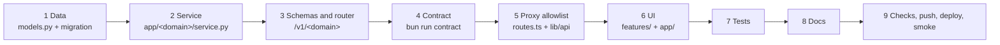

# Adding a feature

> Verified at commit `0e33ec0` (2026-10-26) against `backend/app/main.py`, `backend/app/schemas.py`,
> `backend/app/errors.py`, `backend/app/study/`, `backend/tests/test_route_auth.py`,
> `backend/tests/test_authorization.py`, `frontend/apps/app/src/lib/api/routes.ts` and
> `frontend/apps/app/src/lib/api/study.ts`.

This is the path a feature takes, from the data to production. The **study time** feature (`app/study/`,
`features/study/`, `/study`) is a small, complete example of every step, so open it alongside this page.

**The rules that shape every step:**
- [CLAUDE.md](../CLAUDE.md), "Architecture guardrail" and "The owner's hard rules":
  - durable data and rules live in the API;
  - `/v1` changes are additive;
  - make the smallest safe change, with no new dependencies or services unless needed.
- **Production needs the owner's approval.**



## Contents

- [0. Decide where the rule lives](#0-decide-where-the-rule-lives)
- [1. Data](#1-data)
- [2. Service](#2-service)
- [3. Schemas and the router](#3-schemas-and-the-router)
- [4. The contract](#4-the-contract)
- [5. The proxy allowlist and the client](#5-the-proxy-allowlist-and-the-client)
- [6. The UI](#6-the-ui)
- [7. Tests](#7-tests)
- [8. Docs](#8-docs)
- [9. Checks and release](#9-checks-and-release)
- [A setting or a flag](#a-setting-or-a-flag)
- [A change to what the tutor is told](#a-change-to-what-the-tutor-is-told)

## 0. Decide where the rule lives

- **Anything that must hold for every client** goes in the API: who may see what, limits, what is saved and what
  counts. Future native apps will call the API, not the web app.
- **The web app may mirror a rule for a better experience**, but the API enforces it.
- **The browser's storage is for UI state only.** A user preference belongs in `/v1/me/settings`.

## 1. Data

- Add the table or column to `backend/app/db/models.py`.
- Write an Alembic revision by hand in `backend/alembic/versions/`, numbered after the last one (`0017_…` is the
  latest).
- **It must be backward compatible.** Production migrates before it switches code, and a rollback runs older code
  on the newer schema. So add things, and don't rename or drop them in the same release.
- `tests/test_foundation.py` fails if the models and the migrated schema differ.
- Rows that belong to a student carry `user_id`, so that deleting an account removes them
  ([data-model.md](data-model.md)).

## 2. Service

`app/<domain>/service.py` holds the logic. It is a class that takes the request's `AsyncSession` (the study time
example is `StudyService`):
- **Every query filters by the student.** For example, `StudySession.user_id == user_id`.
- **Another student's row behaves exactly like a missing one.** It raises `NotFound` (404), never 403, so ids
  can't be probed.
- **Errors are the `AppError` classes** in `app/errors.py`: `NotFound`, `Conflict`, `VersionConflict`,
  `RateLimited`, `ValidationFailed`, `ServiceUnavailable` and others. They become the one error envelope,
  `{"error": {"code", "message", "requestId"}}`.
- **Commit explicitly.** `get_session` (`app/db/session.py`) only opens the session, and nothing commits at the
  end of a request. In the example, the service commits (`await self.db.commit()`); some routers commit instead.

## 3. Schemas and the router

- **Schemas** (`app/<domain>/schemas.py`):
  - responses extend `ApiModel`, and requests extend `RequestModel`, both from `app/schemas.py`;
  - both use camelCase on the wire;
  - `RequestModel` rejects unknown fields.
- **The router** (`app/<domain>/router.py`):
  - it starts with `APIRouter(prefix="/v1/<domain>", tags=["<domain>"])`;
  - each route takes `principal: Principal = Depends(get_principal)` (`app/auth/dependencies.py`), plus a factory
    such as `get_study_service`, which builds the service from `Depends(get_session)`.
- **Register the router** in `create_app` (`backend/app/main.py`), with `app.include_router(...)`. That function is
  the only place where things are wired together.
- **The architecture guards** (`tests/test_architecture_guards.py`) fail the build when a module reaches across
  layers:
  - routers never import `app.rag` or pgvector;
  - `app/chat/*` imports only `app.rag.graph`;
  - `app/db/*` never imports LangChain.
- **Keep `/v1` additive.** A breaking change needs a new endpoint or version, while old clients still need the old
  one ([api-contract.md](api-contract.md), "Compatibility").

## 4. The contract

```sh
bun run contract
```

This regenerates two files from the backend: `docs/openapi.json` and the web app's `contract.gen.ts`. Then it runs
the contract tests. Commit both files in the same commit as the change. `bun run build` and CI fail if
`openapi.json` is out of date.

## 5. The proxy allowlist and the client

The browser can reach only the routes listed in `frontend/apps/app/src/lib/api/routes.ts`:

```ts
"GET /v1/study/session": { auth: true },
"POST /v1/study/session": { auth: true, body: "StudyStartIn" },
"GET /v1/study/summary": { auth: true, query: ["days"] },
```

The fields of an entry:
- `auth`: the route needs a signed-in session;
- `body`: the request schema's name in the contract;
- `query`: the query parameters that may pass;
- `stream`: the route answers with Server-Sent Events;
- `session: "clear"`: the route ends the session, so the cookie is cleared;
- `upload` and `file`: for raw bytes.

**Add only what the UI uses.** `routes.test.ts` fails if an entry or a request field doesn't exist in the
contract.

Then add a typed function in `frontend/apps/app/src/lib/api/<domain>.ts`:

```ts
export function getStudyState(signal?: AbortSignal): Promise<StudyState> {
  return callRoute("GET /v1/study/session", { signal });
}
```

`callRoute` accepts only keys of that table, so the compiler rejects a call to a route that isn't allowed.

## 6. The UI

- **Components** go in `frontend/apps/app/src/features/<feature>/`, and shared building blocks in `packages/ui`.
- **A new page** goes in `src/app/(app)/(main)/<path>/page.tsx`, inside the signed-in layout that checks the
  session. A new Settings section goes in `features/settings/`, under `/settings/[section]`.
- **Each screen handles all its states:**
  - loading and empty;
  - an error, shown by its code from `lib/api/errors.ts`, because the proxy never passes on the backend's own
    wording;
  - offline;
  - phone, tablet and desktop widths.
- **Accessibility:**
  - the end-to-end suite runs axe, so use real buttons and labels;
  - keep keyboard focus visible;
  - respect reduced motion.
- **Text size:** fields on touch screens stay at 16 px, at any text size (iOS zooms otherwise).

## 7. Tests

**Backend** (`backend/tests/test_<domain>.py`):
- the fixtures in `conftest.py` give a client against a real PostgreSQL, a fake LLM and an in-memory mailbox;
- helpers such as `register` and `stream_chat` create a student and a chat.

**These checks are automatic, or nearly:**
- `test_route_auth.py` reads every route from the app's own OpenAPI description, and fails if a new route has no
  sign-in dependency. A public route has to be listed in its `PUBLIC` table with a reason; that is a decision for
  the owner.
- `test_authorization.py` checks that another student's resources answer 404. Add the new routes to its list.

**Web app:** unit tests sit next to the code (`*.test.ts`, `bun test`). End-to-end specs are in `e2e/`.

The owner's rule is "no test-suite expansion" unless the owner asks
([CLAUDE.md](../CLAUDE.md), "The owner's hard rules"). Agree the tests a change needs before writing them.

## 8. Docs

Update the page that is the authority for what changed:

| Changed | Update |
|---|---|
| A route | [api-reference.md](api-reference.md) (the contract itself is generated) |
| A table or column | [data-model.md](data-model.md) |
| A setting | [environment-variables.md](environment-variables.md), and the example files |
| What students can do | [features.md](features.md) |
| A new module | [codebase-map.md](codebase-map.md) |
| What the tutor is told | [ai-architecture.md](ai-architecture.md) |

## 9. Checks and release

**The checks before committing** (the owner's rules):
- **Backend:** `ruff check` and `ruff format --check`, then an import check of what changed:
  `.venv\Scripts\python -c "import app.main"`.
- **Frontend:** `bun run typecheck`, `bun run lint`, `bun run test` and `bun run build`.
- **Deploy scripts** (if changed): `bun test deploy/tests`.

**The release, in one pass, with the owner's approval:**
1. Commit on `main`, then `git push origin main`.
2. Run `bun run deploy`. It must end with `Status: MATCH`.
3. Run `bun run status`, then `bun run smoke` (every check PASS), then check what changed on the live site.

How a deploy decides what to rebuild and restart is in [deployment.md](deployment.md).

## A setting or a flag

**Adding a setting:**
- Add it to `Settings` in `backend/app/settings.py`, with a **safe default**. A new feature is usually off by
  default, and turned on in production by the owner.
- If a value would be unsafe in production, add a check to `validate_for_env`, which refuses to start with it.
- Document it in [environment-variables.md](environment-variables.md), and list it in `backend/.env.example` and
  `deploy/env/api.env.example`.
- The web app's settings are read in `frontend/apps/app/src/env.mjs` (or `lib/auth/config.ts` for sign-in).
  Server-only values must never start with `NEXT_PUBLIC_`.

**Tutor features** get their options from one place: `resolve_assistant_config` in `app/chat/assistant.py`. Add a
feature's options there, not in the router.

## A change to what the tutor is told

A rule in the prompt is not a rule the model follows.
1. Change the prompt or the instructions (`app/chat/assistant.py`, `app/learning/tutor.py`, `app/chat/teaching.py`).
2. Measure the change with the real model before releasing it: `scripts/eval_tutor_record.py`, and the JEV eval
   scripts for the classifiers ([ai-architecture.md](ai-architecture.md), "Evaluation").
3. Compare with the change switched off.

On 2026-10-01, a finished test was in the prompt, and 26 of 30 replies were still wrong (CLAUDE.md).
