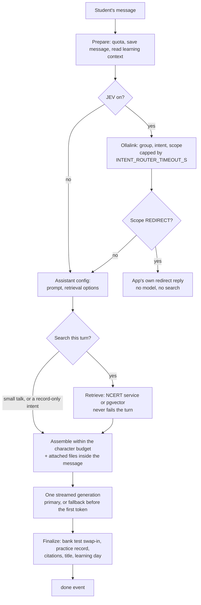
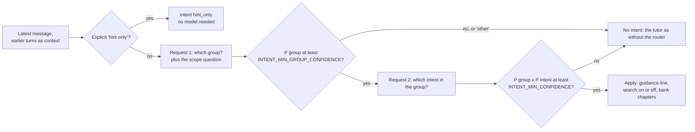
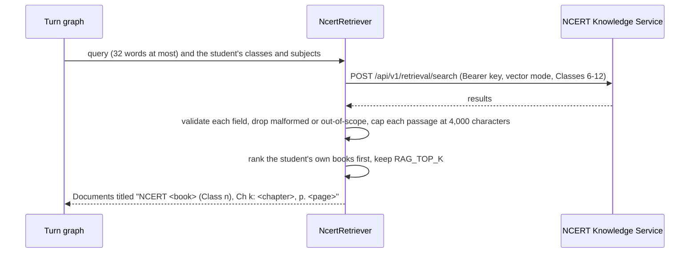

# AI architecture and LLMOps

> Verified at commit `0e33ec0` (2026-10-26) against `backend/app/chat/`, `backend/app/intents/`, `backend/app/rag/`,
> `backend/app/llm/`, `backend/app/qbank/`, `backend/app/voice/`, `backend/app/settings.py` and the `backend/scripts/eval_*.py`
> scripts. Production flag states come from the release session's reports (dated below); they live in `api.env`,
> not in git.

This page explains how PadhAI's tutor produces an answer, first in plain words and then with the exact code
paths. The retrieval details are in [rag.md](rag.md), and the question bank in [question_bank.md](question_bank.md).

## Contents

- [In plain words](#in-plain-words)
- [The pipeline](#the-pipeline)
- [Model providers](#model-providers)
- [What the tutor is told](#what-the-tutor-is-told)
- [JEV: the intent router and the study scope](#jev-the-intent-router-and-the-study-scope)
- [Retrieval](#retrieval)
- [Practice tests from the question bank](#practice-tests-from-the-question-bank)
- [Voice mode](#voice-mode)
- [Flags and their production state](#flags-and-their-production-state)
- [Evaluation](#evaluation)
- [Observability](#observability)
- [Changing things safely](#changing-things-safely)

## In plain words

- An **LLM** (large language model) is the AI that writes the tutor's answers. PadhAI sends it a set of
  instructions plus the conversation, and the model writes the reply word by word; those pieces are **tokens**,
  streamed to the screen as they come.
- **JEV** is PadhAI's name for two small, fast classifications that run before the answer, on Ollalink's
  classification model:
  - **The intent router** reads *what kind of help* the message asks for: explaining, solving, testing and so on,
    46 kinds in all.
  - **The study scope** reads *whether it is something a study tutor should help with*.
  - Both can be off, which is the default.
- **RAG** (retrieval-augmented generation) means looking things up first: PadhAI searches the NCERT textbooks (or
  its own knowledge base) for passages about the question and gives them to the model, so the answer can rest on
  the textbook.
- **Embeddings** are lists of 1,536 numbers that capture what a passage is about. Passages with similar meaning
  have similar numbers, which is how the search finds them (pgvector in PostgreSQL).
- **The question bank** holds stored multiple-choice questions. When a student asks for a test, the questions come
  from it, never from the model, and the database marks the answers.

## The pipeline

Code: `app/chat/service.py` (prepare, `_route`, `_scope`, `_apply`, `_run`, `_finalize`), `app/chat/assistant.py`
(prompt and retrieval options), and `app/rag/graph.py` (`receive_query → retrieve_context → assemble_context →
generate_answer`).

## Model providers

| Piece | Where | Behaviour |
|---|---|---|
| Protocol | `app/llm/base.py` | One `LLMProvider` interface, typed errors (`LLMError`), provider-neutral messages and usage |
| OpenAI-compatible provider | `app/llm/openai_compatible.py` | Any chat-completions API. The defaults are Ollima (`LLM_PRIMARY_BASE_URL`, model `LLM_PRIMARY_MODEL`) and OpenRouter as the fallback (`LLM_FALLBACK_*`; an empty `LLM_FALLBACK_MODEL` means no fallback) |
| Fallback | `app/llm/fallback.py` | Tries providers in order **until one starts streaming**: it never switches after the first token, so a reply never mixes two models |
| Fake | `app/llm/fake.py` | Deterministic, for tests and offline work: it streams `You said: <message>`. Refused in production |
| Factory | `app/llm/factory.py` | Builds the provider from settings, with timeouts (`LLM_CONNECT_TIMEOUT_S` 10, `LLM_FIRST_TOKEN_TIMEOUT_S` 60, `LLM_TOTAL_TIMEOUT_S` 180) |

**There is exactly one model call per turn**, with no graph retries. Two other model uses exist outside the chat
turn:
- the **weekly greeting refresh** (`app/greetings/refresh.py`), whose output is checked line by line before it
  replaces the pool;
- the **evaluation scripts**.

Chat titles come from rules, not from a second model call (`app/chat/titles.py`).

Every generation writes a `usage_events` row (provider, model, tokens, latency, outcome), which is the basis of
the per-student quota. **The app does not compute money cost**: tokens are recorded, and pricing is the
provider's.

## What the tutor is told

`system_prompt_for` in `app/chat/assistant.py` joins these parts in this order, each only when it has something
to say:

1. **The frozen system prompt** (`SYSTEM_PROMPT`), plus the instructions for practice blocks when
   `TUTOR_INTERACTIVE_BLOCKS` is on. These are the question-bank form (`BANK_BLOCKS`) while
   `QUESTION_BANK_TESTS` is on, otherwise `INTERACTIVE_BLOCKS`.
2. **The study scope's policy**, on every turn while `STUDY_SCOPE=on`, plus one line for this turn's decision.
3. **The teaching defaults**, when `TUTOR_TEACHING_POLICY` is on (`app/chat/teaching.py`).
4. **The student's settings** (`app/learning/tutor.py`, `build_tutor_instructions`):
   - class, board, goals, subjects and preferences, plus a "Learning so far" line (streak, today, the time left in
     the India learning day) once they have learnt;
   - their own text only in quotes, as information;
   - never their name, email or photo;
   - capped at 6,000 characters;
   - nothing at all for a student who set nothing.
5. **The voice line**, on a voice turn (short spoken sentences; formulas in words).
6. **The intent's guidance**, one line under "What the latest message asks for", when the router applied an
   intent that has guidance.
7. **The question bank's chapters**, on a turn that asks for a test.
8. **The chat's practice record**: the tests and exercises in this chat as the app recorded them, latest first.

The frozen prompt is pinned by `tests/test_legacy_tutor.py`: a student with nothing set gets exactly the prompt
everyone got before settings existed. **The prompt's text is not reproduced in these docs**; read it in
`assistant.py`. Settings > AI Tutor shows a student what *their* settings add (`POST /v1/learning/tutor-preview`,
computed by the same function).

## JEV: the intent router and the study scope

JEV is the owner's name for the two Ollalink classifications in `app/intents/`. The word itself doesn't appear in
the code.

### The intent router

- **Settings:** `INTENT_ROUTER` is `off`, `shadow` (read and recorded, never applied) or `on`, with the key
  `OLLALINK_API_KEY`.
- **Two stages:** one of 8 groups (or `other`), then one of the intents in that group. Each request is a single
  choice question with short fixed option texts (at most 80 characters), because short options are fast.
  Together they are capped by `INTENT_ROUTER_TIMEOUT_S` (1.5 s by default), never retried, and never fail a turn.
- **The 46 intents** (`TAXONOMY_VERSION` 2026-10-22):

| Group | Intents |
|---|---|
| understand (8) | explain_concept, define_term, why_how, real_life_application, analogy_example, prerequisite_learning, deeper_learning, misconception_check |
| solve (7) | solve_numerical, solve_equation, step_by_step_solution, textbook_exercise, homework_help, alternative_method, word_problem |
| feedback (5) | hint_only, check_answer, debug_solution, marking_rubric, evaluate_written_answer |
| materials (7) | textbook_lookup, chapter_summary, revision_notes, key_points, formula_sheet, flashcards, mind_map |
| language (3) | translation, simplify_text, answer_formatting |
| tests (6) | generate_mcq, conduct_quiz, mock_test, exam_prep, important_topics, difficulty_adjustment |
| planning (2) | performance_analysis, study_schedule |
| visual_lab (8) | diagram_explanation, diagram_labeling, graph_interpretation, image_question_solving, experiment_procedure, observation_inference, lab_safety, project_assignment |

- **What an applied intent changes:**
  - a **guidance line**, for intents that have one;
  - **no knowledge search**, for `performance_analysis` and `study_schedule`, whose answer is in the app's own
    records;
  - **the question bank's chapters**, for `generate_mcq`, `conduct_quiz`, `mock_test` and
    `difficulty_adjustment`.
- **Rules:**
  - An explicit "hint only" (in English, Hindi or Hinglish) is always `hint_only`, with or without the classifier.
  - A regenerated reply reuses its intent.
  - The reading is stored in `messages.metadata.intent` (internal) and logged as metadata only.
- **Thresholds** (`INTENT_MIN_CONFIDENCE`, `INTENT_MIN_GROUP_CONFIDENCE`) are chosen with
  `scripts/eval_intents.py --sweep` on the dev split, then frozen for one run on the test split.

### The study scope

- **Settings:** `STUDY_SCOPE` is `off`, `shadow` or `on` (`app/intents/scope.py`). It asks one more choice
  question within the router's first request: is the message for study, support, unclear, mixed or unrelated?
- **Fixed rules come first:** small talk and a file sent without a question are learning requests, with no model
  needed.
- **Decisions:**
  - `REDIRECT`, only when P(unrelated) reaches `SCOPE_MIN_REDIRECT`: the app's own reply, with no model, search or
    learning day;
  - `CLARIFY`, `PARTIAL_ALLOW` and `ALLOW_SUPPORT` each add one conditional line;
  - everything else is `ALLOW_STUDY`.
- **The policy paragraph** goes into every prompt while `on`, so the tutor itself declines unrelated tasks and
  answers the learning part of a mixed message.
- **Never in a practice chat:** a chat that holds a test or an exercise is never redirected (reason `practice`).
- **Where it's recorded:** `messages.metadata.scope`.

## Retrieval

| Source | When | Details |
|---|---|---|
| **NCERT Knowledge Service** | `NCERT_KB_BASE_URL` and `NCERT_KB_API_KEY` set | A **separate service and repository**, called only through its HTTP API (`app/rag/ncert.py`, `NcertRetriever`): vector mode, Classes 6–12 only, the student's own books ranked first here, at most 32 words of the question sent, `NCERT_KB_TIMEOUT_S` per call, and a 30 s pause after 3 failures in a row. **Its internals (indexing, models, any graph-based retrieval) are not part of this repository and are not documented here** |
| **pgvector knowledge base** | otherwise | `PgVectorRetriever` over `document_chunks`: HNSW cosine search, scoped to global sources plus the student's own, with `RAG_MIN_SCORE` as the floor |
| **Attached files** | always, for the chat's ready attachments | Read exactly, per file, inside the student's message (`AttachedFiles`) |

Every search is skipped or fails with a **reason code** and never fails a turn. The context budget and the
citations (`[1]` for a passage, `[F1]` for a file) are described in [rag.md](rag.md).

## Practice tests from the question bank

With `QUESTION_BANK_TESTS` on (the default):
- a test in the chat is **planned** by the tutor: it names chapters in a `question-bank` block;
- it is **served** by the server: before the reply is saved, the block is replaced with a quiz of stored
  questions. Those may be approved or awaiting review (the owner's decision, 2026-10-16), but never drafts or
  rejected ones (`app/qbank/selection.py`, `SERVABLE`);
- the **database marks** each answer.

With `ADAPTIVE_CHAT_TESTS` on, each answer chooses the next question.

Answers form the student's practice record (mastery by Bayesian knowledge tracing, revision dates, mistakes),
which reaches the tutor as one line and the student on My Learning.

The model never writes, picks or marks a bank question. The tutor's own fill-in-the-blanks exercises are graded
but never count as evidence. Details: [question_bank.md](question_bank.md) and
[api-contract.md, "Practice tests"](api-contract.md#practice-tests).

## Voice mode

`app/voice/` and `frontend/apps/app/src/features/voice/`, with `VOICE_MODE` set to `off`, `qa` or `on`.
- **Hearing:** the browser detects speech itself from the microphone level. A 0.6 s pause ends the question
  (`vad.ts`, `END_MS`), and a soft two-note chime says it was sent. The API transcribes it with OllaLink.
- **Answering:** the words go to the chat as `mode: "voice"`, which adds the voice line to the prompt and one
  `expression` event (the tutor face's manner, derived from the scope and intent readings, never from a model).
- **Speaking:** the reply is read aloud in pieces of a sentence or two with OllaLink's text-to-speech. The very
  first piece may end at a comma after 24 characters (`speech-text.ts`, `FIRST_COMMA`), so the voice starts
  sooner. The API keeps its OllaLink connections open for 60 s (`app/voice/provider.py`, `KEEPALIVE_S`): a new
  TLS connection would cost about 0.3 s before each request.
- **On screen:** only the tutor's face, a state line (such as "Listening…"), any notice, and three controls: back
  to the chat, the microphone, and end. What was said and the reply appear in the chat as ordinary messages.
- **Language:** English only, because OllaLink's speech has no Hindi. Voice is offered only to students whose tutor
  language is English or unset.
- **Storage:** nothing of the audio is stored.

The flow is in [request-lifecycle.md, "A voice turn"](request-lifecycle.md#a-voice-turn).

## Flags and their production state

| Flag | Code default | Production (as reported by the release session) |
|---|---|---|
| `INTENT_ROUTER` | `off` | `on`, with `INTENT_ROUTER_TIMEOUT_S=5` (owner's decision, 2026-10-23; confirmed 2026-10-26) |
| `STUDY_SCOPE` | `off` | `on` (confirmed 2026-10-26) |
| `VOICE_MODE` | `off` | `on` (confirmed 2026-10-26) |
| `QUESTION_BANK_TESTS`, `ADAPTIVE_CHAT_TESTS` | `true` | not reported; the code defaults apply unless `api.env` overrides them |
| `TUTOR_INTERACTIVE_BLOCKS`, `TUTOR_TEACHING_POLICY` | `false` | not reported here |

To confirm a value, read `api.env` on the host the way [deployment.md](deployment.md) describes. Never paste it
anywhere.

## Evaluation

| Script | Measures | Data | How to run |
|---|---|---|---|
| `scripts/eval_intents.py` | Intent router accuracy and latency, with release gates | `tests/fixtures/intent_cases.jsonl` (synthetic, with a dev and a test split) | `--sweep` on the dev split chooses the thresholds; the test split runs once with them frozen; `--probe` and `--replay` compare option texts and the real tutor |
| `scripts/eval_scope.py` | Study scope: false rejections and false acceptances, kept apart | `tests/fixtures/scope_cases.jsonl` | `--sweep` (dev), then the test split once |
| `scripts/eval_retrieval.py` | Knowledge-base retrieval quality, to calibrate `RAG_MIN_SCORE` | your own `{"query", "expected_uri"}` lines | `--cases cases.jsonl` |
| `scripts/eval_tutor_record.py` | Whether the model *uses* the practice record it is given (synthetic records, the real model, a pass-rate gate) | built in | on the host with the production settings: `--runs 5 --min 0.95` |

**A fact in the prompt is not a fact the model uses.** On 2026-10-01 a finished test was in the prompt, yet 26 of
30 replies were still wrong. Run `eval_tutor_record.py` after any change to what the tutor is told.

The two JEV scripts print case ids and numbers only. Results are dated measurements, not guarantees: re-run them
for the configuration you are changing.

## Observability

- **Logs:** JSON, with a request id and user id, and never message or document text, or keys.
  - `rag.retrieval` (status, reason, chunk count, top score, timings) and `rag.graph` (context sizes, history
    kept);
  - the generation's outcome; replies slower than 20 s to the first token, or 120 s in total, are logged as
    warnings (`SLOW_TTFT_MS`, `SLOW_TOTAL_MS`);
  - classifier and voice metadata.
- **Per reply, stored:** `messages.metadata` holds the retrieval summary, intent and scope (internal), and
  `usage_events` the tokens, latency and outcome.
- **Never** turn on LangSmith or LangChain tracing: it would send prompts and documents outside.

## Changing things safely

| Change | How | Verify | Roll back |
|---|---|---|---|
| **The model** | `LLM_PRIMARY_MODEL` (and the base URL and key, if it moves) in `api.env`, then restart the API. That's a production change: the owner approves it | `scripts/eval_tutor_record.py` on the host; a few real questions; watch `usage_events` latency and errors | Restore the previous value and restart |
| **A provider** | A class implementing `LLMProvider` in `app/llm/`, wired in `factory.py`; compose it with `FallbackProvider` | Unit tests with the fake provider; a local run with the real key | Revert the commit (`bun run rollback` if it was deployed) |
| **The prompt** | Edit `assistant.py`, `teaching.py` or `tutor.py`. Changing `SYSTEM_PROMPT` means re-recording the frozen-prompt fixture deliberately | `tests/test_legacy_tutor.py`, `test_tutor_instructions.py`, then `eval_tutor_record.py` on the host | Revert and redeploy |
| **Retrieval** | `RAG_*` and `NCERT_KB_*` settings | `eval_retrieval.py` (pgvector), the `rag.retrieval` logs (NCERT reasons and timings) | Restore the values |
| **JEV thresholds or options** | Thresholds come from `eval_intents.py` and `eval_scope.py` sweeps; changing option texts needs a new `TAXONOMY_VERSION` and a new evaluation | The test split's gates | Set the flag to `shadow` or `off` (a kill switch, no deploy needed beyond the restart) |
| **Embedding model** | `EMBEDDING_MODEL`, then re-ingest. Files become `model_changed` and need Retry. The dimension stays 1536 unless a migration changes it | The startup warning that counts ignored chunks | Restore the model; the old chunks become visible again |
