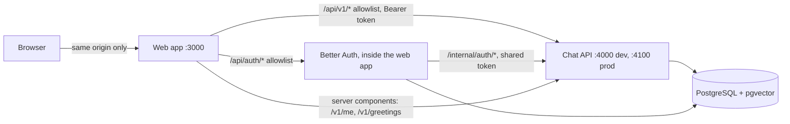

# API reference

> Verified at commit `0e33ec0` (2026-10-26) against every route decorator in `backend/app` (80 routes), the
> generated contract [`openapi.json`](openapi.json), the web app's allowlists (`frontend/apps/app/src/lib/api/routes.ts`,
> `frontend/apps/app/src/lib/auth/routes.ts`) and its route handlers (`frontend/apps/app/src/app/api/`).

This page is the **index**: every route PadhAI has, who may call it, whether a browser can reach it, and where
its code lives.

Request and response shapes, field rules and error codes live in one place,
[api-contract.md](api-contract.md), and the machine-readable truth is [openapi.json](openapi.json), which is
generated from the code (`bun run contract`). If anything here disagrees with them, they win: please fix this
page.

## Contents

- [The four surfaces](#the-four-surfaces)
- [Browser-facing routes of the web app](#browser-facing-routes-of-the-web-app)
- [Sign-in: `/api/auth/*`](#sign-in-apiauth)
- [The chat API: `/v1`](#the-chat-api-v1)
- [Health](#health)
- [Internal: `/internal/auth/*`](#internal-internalauth)
- [Streaming (SSE)](#streaming-sse)
- [Limits and quotas](#limits-and-quotas)
- [Telling errors apart](#telling-errors-apart)
- [Examples](#examples)

## The four surfaces



| Surface | Who calls it | Authentication | Where it is defined |
|---|---|---|---|
| Web app routes (`/api/*` on the site's origin) | the browser | the httpOnly session cookie, checked by the web app | `frontend/apps/app/src/app/api/` |
| Sign-in (`/api/auth/*`) | the browser | Better Auth's own flows (password, email code, Google, two-step) | `frontend/apps/app/src/lib/auth/` |
| Chat API (`/v1/*`) | the web app's server only; a future native app | `Authorization: Bearer <session token>` | `backend/app/*/router.py` |
| Internal (`/internal/auth/*`) | Better Auth, from the web app's server, over loopback | the shared `AUTH_INTERNAL_TOKEN` | `backend/app/auth/internal.py` |

The API listens on loopback and is **never published**. A browser can reach a `/v1` route only through the web
app's proxy, and only if the route is on the allowlist.

## Browser-facing routes of the web app

| Method | Path | What it does | Source |
|---|---|---|---|
| any allowlisted | `/api/v1/*` | The proxy (BFF) to the chat API. It adds the bearer token from the cookie (after verifying its HMAC) and enforces the allowlist (404 otherwise), `Origin` on mutations (403), JSON bodies and the 64 KB limit. SSE passes through unbuffered, and a browser that leaves aborts the reply. | `app/api/v1/[...path]/route.ts`, `lib/server/proxy-core.ts` |
| GET, POST | `/api/auth/*` | Better Auth, limited to the allowlist below. Every JSON answer has its session `token` removed before it leaves. | `app/api/auth/[...all]/route.ts`, `lib/auth/routes.ts` |
| POST | `/api/account/password` | `{newPassword}`: gives an account its first password, which is the last step of sign-up or "Set a password" for a Google account. Needs a sign-in within 15 minutes (409 `reauth_required`). Refuses breached passwords (400 `password_compromised`) and an account that already has one (409 `password_already_set`). Signs out other devices. | `app/api/account/password/route.ts` |
| GET | `/api/session/expired?redirect=` | Where a page goes when the API says 401. It asks the API again, and clears the cookie only if the session really is over; otherwise it sends the student back. | `app/api/session/expired/route.ts`, `lib/server/expired.ts` |
| GET | `/api/health` | The web server is up. For a loopback caller only, it also reports the release it runs and whether sign-in reaches its database (`auth: ok`). | `app/api/health/route.ts` |

## Sign-in: `/api/auth/*`

Exactly these Better Auth routes are served. Anything else is a 404 before Better Auth runs, and Better Auth's own
`disabledPaths` repeat the rule as a second layer.

| Method | Path | Used for |
|---|---|---|
| GET | `/api/auth/get-session` | The current session (token removed) |
| GET | `/api/auth/callback/google` | Google's redirect back |
| GET | `/api/auth/list-accounts` | Which ways the account signs in |
| POST | `/api/auth/sign-in/email` | Email and password |
| POST | `/api/auth/sign-in/social` | Start Google sign-in |
| POST | `/api/auth/sign-out` | Sign out of this device |
| POST | `/api/auth/email-otp/send-verification-otp` | Send a sign-in or sign-up code |
| POST | `/api/auth/sign-in/email-otp` | Sign in, or create the account, with a code |
| POST | `/api/auth/email-otp/request-password-reset` | Send a reset code |
| POST | `/api/auth/email-otp/reset-password` | Reset with the code |
| POST | `/api/auth/change-password` | Change the password (needs a recent sign-in on a two-step account) |
| POST | `/api/auth/link-social`, `/api/auth/unlink-account` | Connect or disconnect Google |
| POST | `/api/auth/two-factor/enable`, `/disable`, `/generate-backup-codes` | Manage two-step sign-in |
| POST | `/api/auth/two-factor/verify-totp`, `/verify-backup-code` | The second step at sign-in |

**Deliberately disabled:**
- sign-up by password, because accounts start with an email code;
- profile, email change and deletion, which are the API's, behind re-authentication;
- session lists and revocation, which are the API's, with masked addresses;
- the password-check oracle and token endpoints;
- email-link verification.

The full list, with the reason for each, is `DISABLED_PATHS` in `lib/auth/routes.ts`.

**Error codes** come from Better Auth and the app's guards (`lib/auth/config.ts`):
- `TOO_MANY_REQUESTS`;
- `CAPTCHA_REQUIRED`, `CAPTCHA_INVALID`, `CAPTCHA_UNAVAILABLE`;
- `PASSWORD_COMPROMISED`, `PASSWORD_CHECK_UNAVAILABLE`;
- `SESSION_NOT_FRESH`, `CODE_ALREADY_USED`.

The sign-in form maps each one to its own message.

## The chat API: `/v1`

76 routes. **Sign-in** "session" means a valid, verified session is required (`get_principal`), and another
student's resources answer 404, exactly like missing ones. **Browser** shows the path through the web app's proxy,
or "not proxied" when no browser can call it.

Not proxied, deliberately:
- `PATCH /v1/me`, deprecated in favour of `/v1/me/profile`;
- `/v1/me/settings`, `POST /v1/chat`, `POST /v1/conversations` and `GET …/feedback`, which the web app doesn't
  use: least privilege;
- `/v1/greetings` and `/v1/greetings/current`, which the web app's server reads directly
  (`lib/server/session.ts`).

### Account and profile

Shapes and rules: [api-contract.md, Account and profile](api-contract.md#auth-and-account).

| Method | Path | Sign-in | Browser (web app) | Source |
|---|---|---|---|---|
| POST | `/v1/auth/logout` | session | `/api/v1/auth/logout` (clears the cookie) | `app/auth/router.py` `logout` |
| GET | `/v1/auth/sessions` | session | `/api/v1/auth/sessions` | `app/auth/router.py` `list_sessions` |
| POST | `/v1/auth/sessions/revoke-others` | session | `/api/v1/auth/sessions/revoke-others` | `app/auth/router.py` `revoke_others` |
| DELETE | `/v1/auth/sessions/{session_id}` | session | `/api/v1/auth/sessions/{session_id}` | `app/auth/router.py` `revoke_session` |
| DELETE | `/v1/me` | session | `/api/v1/me` (clears the cookie) | `app/auth/router.py` `delete_me` |
| GET | `/v1/me` | session | `/api/v1/me` | `app/auth/router.py` `get_me` |
| PATCH | `/v1/me` | session | not proxied | `app/auth/router.py` `update_me` |
| GET | `/v1/me/appearance` | session | `/api/v1/me/appearance` | `app/appearance/router.py` `get_appearance` |
| PATCH | `/v1/me/appearance` | session | `/api/v1/me/appearance` | `app/appearance/router.py` `update_appearance` |
| DELETE | `/v1/me/avatar` | session | `/api/v1/me/avatar` | `app/auth/router.py` `delete_my_avatar` |
| GET | `/v1/me/avatar` | session | `/api/v1/me/avatar` (file response) | `app/auth/router.py` `get_my_avatar` |
| PUT | `/v1/me/avatar` | session | `/api/v1/me/avatar` (raw upload) | `app/auth/router.py` `put_my_avatar` |
| POST | `/v1/me/email/change` | session | `/api/v1/me/email/change` | `app/auth/router.py` `request_email_change` |
| POST | `/v1/me/email/confirm` | session | `/api/v1/me/email/confirm` | `app/auth/router.py` `confirm_email_change` |
| PATCH | `/v1/me/profile` | session | `/api/v1/me/profile` | `app/auth/router.py` `update_my_profile` |
| GET | `/v1/me/settings` | session | not proxied | `app/auth/router.py` `get_my_settings` |
| PATCH | `/v1/me/settings` | session | not proxied | `app/auth/router.py` `update_my_settings` |
| POST | `/v1/messages/{message_id}/assessment-responses` | session | `/api/v1/messages/{message_id}/assessment-responses` | `app/chat/router.py` `respond_to_assessment` |
| POST | `/v1/messages/{message_id}/cancel` | session | `/api/v1/messages/{message_id}/cancel` | `app/chat/router.py` `cancel_message` |
| DELETE | `/v1/messages/{message_id}/feedback` | session | `/api/v1/messages/{message_id}/feedback` | `app/chat/router.py` `delete_feedback` |
| GET | `/v1/messages/{message_id}/feedback` | session | not proxied | `app/chat/router.py` `get_feedback` |
| PUT | `/v1/messages/{message_id}/feedback` | session | `/api/v1/messages/{message_id}/feedback` | `app/chat/router.py` `put_feedback` |

### Greetings

Shapes and rules: [api-contract.md, Greetings](api-contract.md#auth-and-account).

| Method | Path | Sign-in | Browser (web app) | Source |
|---|---|---|---|---|
| GET | `/v1/greetings` | session | not proxied | `app/greetings/router.py` `greeting_pool` |
| GET | `/v1/greetings/current` | session | not proxied | `app/greetings/router.py` `current_greeting` |

### Learning profile

Shapes and rules: [api-contract.md, Learning profile](api-contract.md#learning-what-the-tutor-knows-about-the-student).

| Method | Path | Sign-in | Browser (web app) | Source |
|---|---|---|---|---|
| GET | `/v1/catalog/academic` | none | `/api/v1/catalog/academic` | `app/learning/router.py` `academic_catalog` |
| GET | `/v1/learning/preferences` | session | `/api/v1/learning/preferences` | `app/learning/router.py` `get_learning_preferences` |
| PATCH | `/v1/learning/preferences` | session | `/api/v1/learning/preferences` | `app/learning/router.py` `update_learning_preferences` |
| GET | `/v1/learning/profile` | session | `/api/v1/learning/profile` | `app/learning/router.py` `get_learner_profile` |
| PATCH | `/v1/learning/profile` | session | `/api/v1/learning/profile` | `app/learning/router.py` `update_learner_profile` |
| GET | `/v1/learning/subjects` | session | `/api/v1/learning/subjects` | `app/learning/router.py` `get_subjects` |
| PUT | `/v1/learning/subjects` | session | `/api/v1/learning/subjects` | `app/learning/router.py` `replace_subjects` |
| POST | `/v1/learning/tutor-preview` | session | `/api/v1/learning/tutor-preview` | `app/learning/router.py` `tutor_preview` |

### Progress and streak

Shapes and rules: [api-contract.md, Progress and streak](api-contract.md#progress-active-time-in-padhai).

| Method | Path | Sign-in | Browser (web app) | Source |
|---|---|---|---|---|
| GET | `/v1/progress` | session | `/api/v1/progress` | `app/progress/router.py` `get_progress` |
| POST | `/v1/progress/activity` | session | `/api/v1/progress/activity` | `app/progress/router.py` `report_activity` |
| GET | `/v1/progress/learning-days` | session | `/api/v1/progress/learning-days` | `app/progress/router.py` `get_learning_days` |
| GET | `/v1/progress/streak` | session | `/api/v1/progress/streak` | `app/progress/router.py` `get_learning_streak` |

### Practice record

Shapes and rules: [api-contract.md, Practice record](api-contract.md#the-practice-record).

| Method | Path | Sign-in | Browser (web app) | Source |
|---|---|---|---|---|
| GET | `/v1/progress/mastery` | session | `/api/v1/progress/mastery` | `app/progress/router.py` `get_mastery` |
| GET | `/v1/progress/mistakes` | session | `/api/v1/progress/mistakes` | `app/progress/router.py` `get_mistakes` |
| GET | `/v1/progress/plan` | session | `/api/v1/progress/plan` | `app/progress/router.py` `get_practice_plan` |
| GET | `/v1/progress/practice-tests` | session | `/api/v1/progress/practice-tests` | `app/progress/router.py` `get_practice_tests` |
| GET | `/v1/progress/practice-topics` | session | `/api/v1/progress/practice-topics` | `app/progress/router.py` `get_practice_topics` |
| GET | `/v1/progress/revisions` | session | `/api/v1/progress/revisions` | `app/progress/router.py` `get_revisions` |

### Study time

Shapes and rules: [api-contract.md, Study time](api-contract.md#study-time-estimated-in-the-sessions-a-student-starts).

| Method | Path | Sign-in | Browser (web app) | Source |
|---|---|---|---|---|
| POST | `/v1/study/beat` | session | `/api/v1/study/beat` | `app/study/router.py` `study_beat` |
| GET | `/v1/study/chapters` | session | `/api/v1/study/chapters` | `app/study/router.py` `get_study_chapters` |
| GET | `/v1/study/session` | session | `/api/v1/study/session` | `app/study/router.py` `get_study_session` |
| POST | `/v1/study/session` | session | `/api/v1/study/session` | `app/study/router.py` `start_study_session` |
| PATCH | `/v1/study/session/{session_id}` | session | `/api/v1/study/session/{session_id}` | `app/study/router.py` `change_study_context` |
| POST | `/v1/study/session/{session_id}/end` | session | `/api/v1/study/session/{session_id}/end` | `app/study/router.py` `end_study_session` |
| POST | `/v1/study/session/{session_id}/pause` | session | `/api/v1/study/session/{session_id}/pause` | `app/study/router.py` `pause_study_session` |
| POST | `/v1/study/session/{session_id}/resume` | session | `/api/v1/study/session/{session_id}/resume` | `app/study/router.py` `resume_study_session` |
| GET | `/v1/study/summary` | session | `/api/v1/study/summary` | `app/study/router.py` `get_study_summary` |

### Conversations

Shapes and rules: [api-contract.md, Conversations](api-contract.md#conversations).

| Method | Path | Sign-in | Browser (web app) | Source |
|---|---|---|---|---|
| GET | `/v1/conversations` | session | `/api/v1/conversations` | `app/conversations/router.py` `list_conversations` |
| POST | `/v1/conversations` | session | not proxied | `app/conversations/router.py` `create_conversation` |
| DELETE | `/v1/conversations/{conversation_id}` | session | `/api/v1/conversations/{conversation_id}` | `app/conversations/router.py` `delete_conversation` |
| GET | `/v1/conversations/{conversation_id}` | session | `/api/v1/conversations/{conversation_id}` | `app/conversations/router.py` `get_conversation` |
| PATCH | `/v1/conversations/{conversation_id}` | session | `/api/v1/conversations/{conversation_id}` | `app/conversations/router.py` `rename_conversation` |
| GET | `/v1/conversations/{conversation_id}/messages` | session | `/api/v1/conversations/{conversation_id}/messages` | `app/conversations/router.py` `list_messages` |

### Chat

Shapes and rules: [api-contract.md, Chat](api-contract.md#chat).

| Method | Path | Sign-in | Browser (web app) | Source |
|---|---|---|---|---|
| POST | `/v1/chat` | session | not proxied | `app/chat/router.py` `chat_complete` |
| POST | `/v1/chat/stream` | session | `/api/v1/chat/stream` (SSE) | `app/chat/router.py` `chat_stream` |
| POST | `/v1/conversations/{conversation_id}/regenerate/stream` | session | `/api/v1/conversations/{conversation_id}/regenerate/stream` (SSE) | `app/chat/router.py` `regenerate_stream` |

### File Library

Shapes and rules: [api-contract.md, File Library](api-contract.md#files-the-file-library).

| Method | Path | Sign-in | Browser (web app) | Source |
|---|---|---|---|---|
| GET | `/v1/files` | session | `/api/v1/files` | `app/files/router.py` `list_files` |
| POST | `/v1/files` | session | `/api/v1/files` (raw upload) | `app/files/router.py` `upload_file` |
| DELETE | `/v1/files/{file_id}` | session | `/api/v1/files/{file_id}` | `app/files/router.py` `delete_file` |
| GET | `/v1/files/{file_id}` | session | `/api/v1/files/{file_id}` | `app/files/router.py` `get_file` |
| GET | `/v1/files/{file_id}/content` | session | `/api/v1/files/{file_id}/content` (file response) | `app/files/router.py` `file_content` |
| POST | `/v1/files/{file_id}/retry` | session | `/api/v1/files/{file_id}/retry` | `app/files/router.py` `retry_file` |

### Voice

Shapes and rules: [api-contract.md, Voice](api-contract.md#voice).

| Method | Path | Sign-in | Browser (web app) | Source |
|---|---|---|---|---|
| GET | `/v1/voice` | session | `/api/v1/voice` | `app/voice/router.py` `get_voice` |
| POST | `/v1/voice/speech` | session | `/api/v1/voice/speech` (file response, voice class) | `app/voice/router.py` `speak` |
| POST | `/v1/voice/transcriptions` | session | `/api/v1/voice/transcriptions` (raw upload, voice class) | `app/voice/router.py` `transcribe` |

### Notifications

Shapes and rules: [api-contract.md, Notifications](api-contract.md#notifications).

| Method | Path | Sign-in | Browser (web app) | Source |
|---|---|---|---|---|
| GET | `/v1/notifications` | session | `/api/v1/notifications` | `app/notifications/router.py` `list_notifications` |
| POST | `/v1/notifications/clear` | session | `/api/v1/notifications/clear` | `app/notifications/router.py` `clear_notifications` |
| GET | `/v1/notifications/preferences` | session | `/api/v1/notifications/preferences` | `app/notifications/router.py` `get_notification_preferences` |
| PATCH | `/v1/notifications/preferences` | session | `/api/v1/notifications/preferences` | `app/notifications/router.py` `update_notification_preferences` |
| POST | `/v1/notifications/read` | session | `/api/v1/notifications/read` | `app/notifications/router.py` `mark_notifications_read` |
| POST | `/v1/notifications/unsubscribe` | none | `/api/v1/notifications/unsubscribe` | `app/notifications/router.py` `unsubscribe` |

### Support

Shapes and rules: [api-contract.md, Support](api-contract.md#support).

| Method | Path | Sign-in | Browser (web app) | Source |
|---|---|---|---|---|
| POST | `/v1/support/requests` | session | `/api/v1/support/requests` | `app/support/router.py` `create_support_request` |

**No session needed:**
- `GET /v1/catalog/academic`: the academic catalog (`ETag`, 304);
- `POST /v1/notifications/unsubscribe`: the email's signed token is the credential, limited to 30 a minute per
  address.

## Health

| Method | Path | Answer | Source |
|---|---|---|---|
| GET | `/health` | `{"status": "ok", "release": "<commit or development>", "files": "available" or "unavailable"}`: liveness | `backend/app/health.py` |
| GET | `/ready` | `{"status", "database"}`, 503 when the database is unreachable: readiness | `backend/app/health.py` |

Interactive API docs (`/docs`, `/openapi.json`) exist only when `APP_ENV` is not `production`.

## Internal: `/internal/auth/*`

| Method | Path | Purpose |
|---|---|---|
| POST | `/internal/auth/code` | Email a sign-in or reset code that Better Auth just created. Sent only when the code's hash matches a fresh verification row |
| POST | `/internal/auth/events` | Raise a security notice or welcome email (`sign_in`, `password_changed`, `password_reset`, `google_linked`, `two_factor_on`, `two_factor_off`). Counted only when the rows it names exist and are fresh |

**Security requirement:**
- These routes exist only when `AUTH_INTERNAL_TOKEN` is set, and answer 404 to any caller without the matching
  `x-internal-token`.
- The API listens on loopback, and the web app's proxy never forwards `/internal`.
- They're hidden from the OpenAPI contract.
- Never expose them, and never call them by hand.

## Streaming (SSE)

`POST /v1/chat/stream` and `POST /v1/conversations/{id}/regenerate/stream` answer with `text/event-stream`. Events
arrive in this order:

1. `: open`.
2. `meta`: the conversation, the student's message and the reply's id.
3. Optionally `citations`, and for a voice turn `expression`, at most once each and before the first token.
4. `token`, repeated.
5. `: keepalive` every 15 seconds without output.
6. Exactly one of `done` (the final message, conversation and optional `learning`) or `error` (`code`,
   `retryable`, `requestId`).

Unknown events must be ignored. The concatenated tokens equal `done.message.content`.

To stop a reply, send `POST /v1/messages/{assistantMessageId}/cancel`, then read until `done` (whose status is
`cancelled`). Closing the connection also stops it. Never re-send after an interrupted stream: re-read the
conversation instead. Full rules: [api-contract.md, "Server-Sent Events"](api-contract.md#server-sent-events).

## Limits and quotas

| What | Limit | Where it is enforced |
|---|---|---|
| Replies per student | `CHAT_GENERATIONS_PER_MINUTE` (20) and `CHAT_GENERATIONS_PER_DAY` (500), then 429 `rate_limited` | API, `usage_events` |
| One reply at a time per chat | 409 `conflict` while one is streaming | API |
| Message length | 1–16,000 characters (`CHAT_MAX_MESSAGE_CHARS`); at most 5 ready attachments | API |
| JSON body | 64 KB (413 `payload_too_large`) | web app proxy and API |
| Profile photo | 5 MB upload, 10 per 15 minutes | API |
| File Library | 25 MB per upload (by type), 100 MB per student, 500 files, 5 being read, 20 uploads per 15 minutes and 30 a day | API ([api-contract.md, "Files"](api-contract.md#files-the-file-library)) |
| Voice | transcriptions 20/min and 400/day; speech 120/min and 3000/day; 1 and 2 at once per student, 8 and 16 in all; 8,000 characters of speech per reply; audio up to 1 MiB and 60 s | API (`auth_attempts`, plus counters in the process) |
| Tutor preview | 60 a minute | API, in-process limiter |
| Activity reports | 6 a minute | API, in-process limiter |
| Study beats and actions | 30 a minute each | API, in-process limiters |
| Support requests | 5 an hour, 20 a day, at most 30 open | API |
| Email change | 3 per 15 minutes | API |
| Password checks | 10 per 15 minutes per account (sign-in, change and re-authentication together) | web app `lib/auth/guard.ts` and API, both in `auth_attempts` |
| Codes | 5 sent per 15 minutes and 20 a day per address; 20 checks a day | web app `lib/auth/guard.ts` |
| Better Auth, per IP per minute | 120 by default; `/sign-in/email` 60, `/sign-in/social` 20, email-code routes 30, `/change-password` 10, `/two-factor/*` 20 | web app, in memory |

In-process limiters live in one API process's memory (`app/ratelimit.py`), and production runs exactly one API
process. Limits kept in `auth_attempts` hold across processes and restarts.

## Telling errors apart

Every API error has one shape, `{"error": {"code", "message", "requestId"}}`, plus `fields` on 422 and `current` on
409 `version_conflict`. Decide on the `code`, never on the message text. The web app shows its own words per code
(`lib/api/errors.ts`).

| Kind | How you see it |
|---|---|
| Client validation | 422 `validation_error` with `fields: [{field, reason}]` (values are never echoed). An unknown field is also 422 |
| Not signed in | 401 `unauthorized`. The proxy itself answers 401 when the cookie is missing, and clears the cookie on an upstream 401 |
| Not allowed, or not yours | 404 `not_found`: another student's resource looks exactly like a missing one. 403 `email_not_verified` for an unverified address; 403 `forbidden` from the proxy for a cross-origin mutation |
| Rate limit or quota | 429 `rate_limited` (or `too_many_open_requests`, `too_many_pending_files`) |
| Busy or conflicting state | 409 `conflict` (a reply already streaming), `version_conflict`, `reauth_required`, `study_state_changed`, the `assessment_*` codes |
| Model provider failure | In a stream, the `error` event's `llm_unavailable`, `llm_timeout` or `llm_bad_request` (`retryable` says whether to offer Retry). `POST /v1/chat` answers 502/504/422 |
| Dependency down | 503 `service_unavailable` (database or email), `files_unavailable`, `voice_unavailable` |
| Server bug | 500 `internal_error`: report the `requestId`, which is also in the API's logs |

The full code list is in [api-contract.md, "Conventions"](api-contract.md#conventions) and each section of that
file.

## Examples

These are for a **local development** stack (`bun run dev`). The URLs are local, and a placeholder stands in for
every secret.

```sh
# Liveness and readiness of the API
curl http://127.0.0.1:4000/health
curl http://127.0.0.1:4000/ready

# The public academic catalog (no session needed)
curl http://127.0.0.1:4000/v1/catalog/academic

# A streamed answer through the web app, as the browser sends it.
# <cookie> is your local session cookie (padhai_session=...), copied from your own browser's developer tools
# after signing in to http://localhost:3000 with a test account. Never use a real student's session.
curl -N http://localhost:3000/api/v1/chat/stream \
  -H "Origin: http://localhost:3000" -H "Content-Type: application/json" \
  -H "Cookie: <cookie>" \
  -d '{"message": "Explain photosynthesis in two sentences."}'
```

The stream prints `: open`, an `event: meta` line with its JSON, `event: token` lines, then `event: done`. With
`LLM_PROVIDER=fake`, the tokens spell `You said: Explain photosynthesis in two sentences.`

## Related

- [api-contract.md](api-contract.md): shapes, fields, error codes, compatibility and client obligations.
- [request-lifecycle.md](request-lifecycle.md): what happens inside a chat turn.
- [security.md](security.md): the trust boundaries these surfaces implement.
