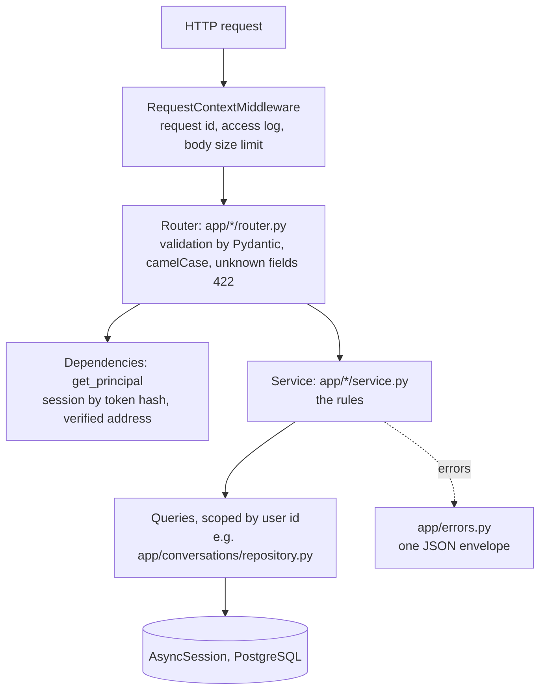

# Backend architecture

> Verified at commit `0e33ec0` (2026-10-26) against `backend/app/main.py`, `middleware.py`, `errors.py`,
> `ratelimit.py`, `logging.py`, the routers and services named below, and `backend/tests/`.

The backend is one **FastAPI** application (Python 3.12, SQLAlchemy 2 async with asyncpg, Alembic) in
`backend/`. It is the authority for all data and every rule; the web app is its first client. The system-level
view is [architecture.md](architecture.md); this page is the inside of the API.

## Contents

- [Start-up: the composition root](#start-up-the-composition-root)
- [A request, layer by layer](#a-request-layer-by-layer)
- [Domain packages](#domain-packages)
- [Background work](#background-work)
- [Outside providers](#outside-providers)
- [Errors, logging and limits](#errors-logging-and-limits)
- [Rules the tests enforce](#rules-the-tests-enforce)
- [Tests and fixtures](#tests-and-fixtures)

## Start-up: the composition root

`uvicorn app.main:create_app --factory`. Development runs it on `127.0.0.1:4000` with `--reload`
(`scripts/run.mjs`); production runs it on `127.0.0.1:4100` with `--proxy-headers --forwarded-allow-ips 127.0.0.1`
(`deploy/systemd/aichat-api.service`).

`create_app(settings, *, llm, email_sender, embeddings, intents, voice)` is the **only** place where concrete
implementations are wired; tests pass fakes through the same parameters. In order, it:

1. Validates the settings for the environment (`validate_for_env`: production refuses unsafe values) and refuses
   to start if `EMBEDDING_DIMENSIONS` differs from the database's `vector(1536)`.
2. Builds the long-lived pieces on `app.state`:
   - the LLM provider, the embeddings and the email sender;
   - password hashing;
   - the registry of running generations and the weekly greeting refresh;
   - the in-process limiters (tutor preview, activity, study beats and actions, unsubscribe);
   - the voice provider, its in-flight counters and the speech budget.
3. Installs the error handlers, CORS (only if `ALLOWED_ORIGINS` is set), and the two middlewares
   (`RequestContextMiddleware`, `ClassifierWarmMiddleware`).
4. Includes the 14 routers: health, auth, internal auth, conversations, chat, learning, progress, notifications,
   voice, support, appearance, greetings, files, study.

On start (the **lifespan**), it:
- opens the database;
- chooses the knowledge source: the NCERT service when configured, otherwise pgvector;
- builds the LangGraph turn graph (`build_rag`);
- creates Ollalink's classifier, only when JEV is on and keyed;
- creates the `ChatService` and starts the file worker (its sandbox self-test runs in the background, so files
  never delay start-up);
- marks replies left `streaming` as interrupted;
- warns about chunks from another embedding model;
- starts the hourly auth clean-up.

On stop, it closes all of these in reverse.

## A request, layer by layer

| Layer | Where | Rule |
|---|---|---|
| Middleware | `app/middleware.py` | Pure ASGI: an `X-Request-ID` (validated, or generated), one access log line, the body limit (64 KB, with per-route limits for the photo, file and voice uploads). `ClassifierWarmMiddleware` nudges Ollalink after a quiet spell (`OLLALINK_WARM_AFTER_S`) |
| Schemas | `app/schemas.py`, `app/*/schemas.py` | `RequestModel`: camelCase on the wire, snake_case in Python, unknown fields rejected (422) |
| Identity | `app/auth/dependencies.py` | The caller comes **only** from a server-verified session token: SHA-256 lookup in `auth_sessions`, a verified address required |
| Routers | `app/*/router.py` | Translate HTTP only. They never import retrieval code or pgvector (an architecture guard). One accepted exception: feedback is written directly in `app/chat/router.py` |
| Services | `app/*/service.py` | The rules: quotas, versioned edits, ownership, state machines |
| Persistence | `app/db/models.py`, `app/db/session.py` | One `AsyncSession` per request (`get_session`); the request's work commits together |

## Domain packages

| Package | Responsibility |
|---|---|
| `auth` | Sessions, devices (a coarse label and a masked address), email change, account deletion, re-authentication, the profile photo, throttling (`_throttle` under an advisory lock), hourly retention, and the internal routes Better Auth calls |
| `appearance` | `/v1/me/appearance`: theme, text size, contrast, motion, reading comfort, streak visibility |
| `learning` | The academic catalog, learner profile, subjects, learning preferences, and `tutor.py`: what the settings add to the tutor's instructions |
| `conversations` | List, create, rename, delete, message history, every query scoped by user (`repository.py`) |
| `chat` | `ChatService` (prepare, generate, finalize), SSE and the generation registry (`streams.py`), the assistant config (`assistant.py`), teaching defaults, titles |
| `intents` | JEV: the intent taxonomy, the Ollalink classifier, the study scope |
| `rag` | The LangGraph turn graph, retrievers (pgvector, attached files, NCERT), the knowledge store, embeddings, ingestion, the context budget |
| `llm` | The provider protocol, the OpenAI-compatible provider, fallback, fake |
| `files` | The File Library: upload rules, the background worker, the sandboxed extractor |
| `assessments` | Practice tests and exercises in replies: built, stored and graded by the server |
| `qbank` | The question bank: validation, import, selection, tests in the chat |
| `progress` | Active time, the learning streak (`learning.py`), the practice record (`practice.py`) |
| `study` | Study sessions, segments, beats and the credited active time |
| `notifications` | Preferences, the bell, the email outbox, reminders, alerts, unsubscribe tokens, the sender |
| `support` | Support requests |
| `greetings` | The weekly greeting pool and its refresh by the LLM |
| `voice` | Voice mode: the rollout and language policy, the OllaLink provider, the face's expression, `/v1/voice` |
| `jobs` | The jobs worker (`python -m app.jobs`) |

A one-line description of every module is in [codebase-map.md](codebase-map.md).

## Background work

| Work | Runs where | When | Notes |
|---|---|---|---|
| **Generation** of a reply | an asyncio task in the API (`ActiveGenerations`) | per chat turn | Independent of the request, so the reply is saved even if the client leaves. Stopped by cancel, a disconnect, or the database's stop flag |
| **File worker** | an asyncio worker in the API (`app/files/processing.py`) | continuously | PostgreSQL leases, so a restart or deploy loses nothing; each file is parsed in a sandboxed systemd unit |
| **Greeting refresh** | an asyncio task in the API | the first request of a new week | Never awaited by the request; any failure keeps the old pool |
| **Auth retention** | an asyncio task in the API | 5 minutes after start, then hourly | Independent of the jobs worker |
| **Jobs worker** | a separate one-shot process (`aichat-jobs.timer`) | every minute, **when enabled** | The email outbox (at most once), reminders, notification and outbox retention. It holds an advisory lock, so only one runs. Installed but **not enabled** in production ([deployment.md, "Jobs worker"](deployment.md#jobs-worker)) |

## Outside providers

All of them are built in `create_app` or its factories, configured by settings, and replaceable with fakes in
tests.

| Provider | Module | Fake for tests |
|---|---|---|
| LLM (Ollima, OpenRouter, any OpenAI-compatible API) | `app/llm/` | `FakeProvider` (`LLM_PROVIDER=fake`) |
| Embeddings (OpenAI-compatible) | `app/rag/embeddings.py` | keyword hashing (`EMBEDDING_PROVIDER=fake`) |
| NCERT Knowledge Service | `app/rag/ncert.py` | a fake service in `test_ncert.py` |
| Ollalink classifier (JEV) | `app/intents/classifier.py` | injected through `intents=` |
| OllaLink speech (voice) | `app/voice/provider.py` | `VOICE_PROVIDER=fake` |
| Email (SMTP, Ollastack) | `app/auth/emails.py` | `EMAIL_BACKEND=memory` |

## Errors, logging and limits

- **Errors** (`app/errors.py`): typed application errors map to one envelope,
  `{"error": {code, message, requestId}}`, plus `fields` (422) or `current` (409 `version_conflict`). The `message`
  is safe to show; clients decide on the `code`.
- **Logging** (`app/logging.py`): structured JSON with the request id from a context variable. It never contains
  message or document text, codes or keys, and provider errors have key-like strings redacted.
- **Limits:**
  - `app/ratelimit.py` is an in-process sliding window (one API process in production);
  - the per-account and per-student limits that must survive restarts live in `auth_attempts`;
  - reply quotas count `usage_events`.

  The full list is in [api-reference.md, "Limits and quotas"](api-reference.md#limits-and-quotas).

## Rules the tests enforce

`tests/test_architecture_guards.py`:
- routers never import `app.rag` or pgvector;
- `app/chat/*` imports only `app.rag.graph` from the RAG layer;
- the graph depends on abstractions only;
- `app/db/*` and the store never import LangChain or LangGraph;
- no other vector database or external graph retrieval is referenced or installed;
- questions are picked, served and checked by SQL and fixed rules only.

Three more checks:
- `tests/test_foundation.py` keeps the models and the migrations in parity.
- `tests/test_route_auth.py` reads every route from the app's own OpenAPI description and fails one without an
  auth dependency, unless it is on the recorded public list. Hiding a route from the description, to escape the
  check, is refused too.
- `tests/test_authorization.py` checks that another user's resources answer 404, exactly like missing ones.

## Tests and fixtures

- **The suite:** `pytest` in `backend/tests/`, 40 test files. Each test runs against a real PostgreSQL with
  pgvector.
  - `conftest.py` drops, recreates and migrates its own database. The name **must** end in `_test`.
  - Tables are truncated before each test.
  - The fakes are the LLM, the embeddings and an in-memory mailbox.
- **Run it** (from `backend/`): `.venv\Scripts\python -m pytest -o addopts="" -ra` on Windows,
  `.venv/bin/python -m pytest …` on Linux. Add `-k name` for one test. It needs PostgreSQL and Mailpit running
  ([testing.md](testing.md)).
- **Lint:** `ruff check .` and `ruff format --check .` (`backend/pyproject.toml`).
- **The contract:** `python scripts/export_openapi.py --check` fails when `docs/openapi.json` is stale; `bun run
  contract` regenerates it.
