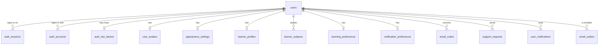
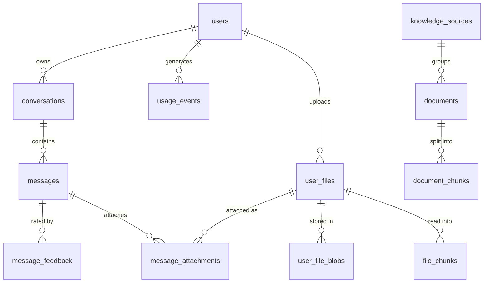
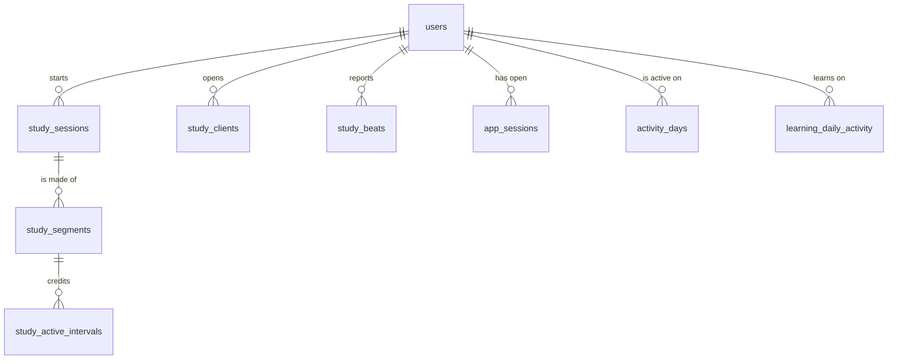
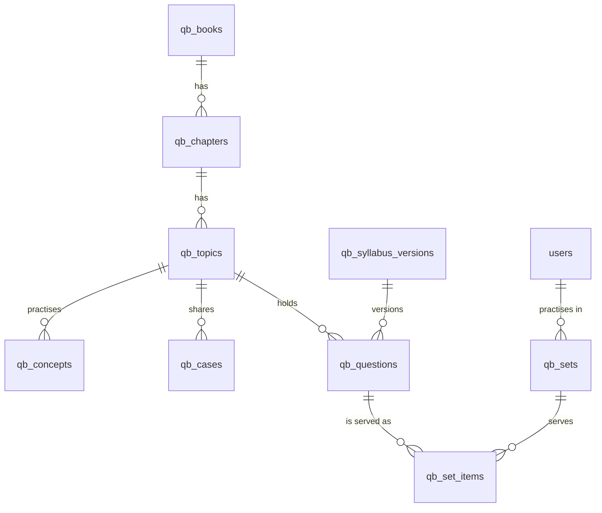

# Data model

> Verified at commit `0e33ec0` (2026-10-26) against `backend/app/db/models.py` (46 tables) and the Alembic chain
> `backend/alembic/versions/0001_initial` … `0017_learning_engine`. Examples are synthetic; no real student data
> appears here.

PadhAI keeps **everything in one PostgreSQL 16 database** with the pgvector extension: accounts, chats, files
(their bytes too), vectors, progress and the question bank. There is no other database, no vector store on disk
and no authoritative state in memory.

`backend/app/db/models.py` is the schema's single source of truth, and every change to it ships with a
hand-written Alembic migration. `tests/test_foundation.py` checks that the models and the migrations agree.

## Contents

- [Ownership: the one rule](#ownership-the-one-rule)
- [Tables by domain](#tables-by-domain)
- [Relationships (ER diagrams)](#relationships-er-diagrams)
- [Vectors](#vectors)
- [Statuses worth knowing](#statuses-worth-knowing)
- [Retention and deletion](#retention-and-deletion)
- [Migrations](#migrations)
- [Database roles and backups](#database-roles-and-backups)
- [Development data](#development-data)

## Ownership: the one rule

Every row that belongs to a student references `users.id`, with `ON DELETE CASCADE` almost everywhere, and every
query that reads or writes it is scoped by the caller's id (`app/conversations/repository.py`,
`app/learning/service.py` and the other services).

Another student's row is indistinguishable from a missing one: the API answers 404. `tests/test_authorization.py`
checks this across the API.

App-level content that belongs to nobody (the question bank, the weekly greetings, global knowledge sources) has
no user column, or a `NULL` owner.

## Tables by domain

**Accounts and identity**

| Table | Holds |
|---|---|
| `users` | One account: email (case-insensitive), display name, verified flag, time zone, profile version |
| `auth_sessions` | One signed-in device: the SHA-256 of its token (kept by a trigger), expiry, coarse device data |
| `auth_accounts` | A way to sign in (Better Auth's `account`): `credential` holds the argon2id hash; `google` a linked Google account |
| `auth_two_factors` | Better Auth's two-step secret and recovery codes (0013) |
| `auth_verifications` | Better Auth's email codes and OAuth states, by identifier |
| `email_codes` | The API's own codes (email change): an HMAC, never the code |
| `auth_attempts` | Throttling counters, with hashed keys only |
| `user_avatars` | The profile photo, re-encoded as a 256 px WebP of at most 64 KB |
| `user_settings` | Free-form client preferences (JSONB, ≤ 4 KB) |
| `appearance_settings` | Theme, text size, contrast, motion, reading comfort and streak visibility, the same on every device |

**What the tutor knows about the student**

| Table | Holds |
|---|---|
| `learner_profiles` | Class, board, medium, academic year, goals, weak topics, exam date (catalog codes plus short text), versioned |
| `learner_subjects` | The ordered subject list, with priority and needs-improvement flags |
| `learning_preferences` | How the student wants to be taught: one typed column per preference, each `auto` by default |

**Progress and study time**

| Table | Holds |
|---|---|
| `activity_days` | Active minutes and questions per local day |
| `learning_daily_activity` | A learning day in India time: the basis of the streak (`app/progress/learning.py`) |
| `study_sessions` | One study session, from Start to End (or stale, or the 8-hour limit) |
| `study_segments` | A stretch of a session in one state (studying or paused) and one context (subject, chapter, activity) |
| `study_active_intervals` | Credited active time, which can only exist inside a studying segment (composite foreign key) |
| `study_clients` | One page load's last observation (a tab or a device) |
| `study_beats` | Beat ids already received, so a retried beat changes nothing |
| `app_sessions` | A run of time with PadhAI open (visible or not) |

**Chat**

| Table | Holds |
|---|---|
| `conversations` | A chat: owner, title, metadata |
| `messages` | User and assistant messages: content exactly as produced, `status`, metadata (citations, assessments, intent, scope, the retrieval summary) |
| `message_feedback` | Thumbs up or down, and an optional comment, per assistant message |
| `message_attachments` | A file attached to a user message; the filename stays when the file is deleted |
| `usage_events` | One per generation: provider, model, tokens, latency, outcome (also the basis of the reply quota) |

**Knowledge and files**

| Table | Holds |
|---|---|
| `knowledge_sources` | A named collection; `owner_user_id` NULL means global (visible to every signed-in student) |
| `documents` | One ingested document per (source, uri), with its content hash and ingest signature |
| `document_chunks` | A retrievable passage with `embedding vector(1536)` and the model that made it |
| `user_files` | One file in a student's File Library: one row per (student, bytes), with kind, size and status |
| `user_file_blobs` | The file's bytes in 1 MiB pieces, read and written one row at a time |
| `file_chunks` | A passage of a student's file with its embedding. Derived data, excluded from backups |

**Notifications and support**

| Table | Holds |
|---|---|
| `notification_preferences` | Which emails a student wants (reminders off, sign-in alerts on), versioned |
| `user_notifications` | The bell's items, deduplicated by key |
| `email_outbox` | Emails for the jobs worker to send, at most once |
| `support_requests` | A student's question or report, kept until the account is deleted |
| `study_greetings` | The weekly greeting pool above a new chat (app-level) |

**Question bank and practice** ([question_bank.md](question_bank.md))

| Table | Holds |
|---|---|
| `qb_syllabus_versions` | A curriculum's syllabus for one academic session |
| `qb_books`, `qb_chapters`, `qb_topics`, `qb_concepts`, `qb_cases` | The curriculum tree: book (class, subject, language), chapter, topic, concept with its learning objective, and shared passages |
| `qb_questions` | One stored multiple-choice question, with its place in the tree, difficulty, format, competency, source and review status, all enforced by checks |
| `qb_sets` | A practice set or test, including a test in the chat (mode `chat`) |
| `qb_set_items` | A question served in a set, and the student's answer, graded by the database and final once given |

## Relationships (ER diagrams)

Only keys and relationships are shown; `models.py` has every column.

## Vectors

| Column | Dimension | Index | Used for |
|---|---|---|---|
| `document_chunks.embedding` | 1536 | HNSW, cosine (`ix_document_chunks_embedding_hnsw`), plus btree `(source_id, embedding_model)` and GIN on metadata | The knowledge base (when the NCERT service is not configured) |
| `file_chunks.embedding` | 1536 | none: files are searched exactly, per file | A student's attached files |

The dimension is fixed at **1536** in three places that a test keeps in sync:
- `EMBEDDING_DIMENSIONS` in `models.py`;
- the `EMBEDDING_DIMENSIONS` setting, which the API refuses to start with when it differs;
- the migrations.

Changing it means a new migration and a full re-ingest. Chunks record their `embedding_model`, so vectors from
different models never mix ([rag.md](rag.md), "Embeddings").

## Statuses worth knowing

| Column | Values |
|---|---|
| `messages.status` | `complete`, `streaming` (being generated), `cancelled` (stopped; partial text kept), `error` (failed; partial text kept), `superseded` (replaced by a regeneration; hidden) |
| `user_files.status` | `processing`, `ready` (the tutor can use it), `failed` (with `errorCode` and `retryable`), `stored` (kept, but files can't be read right now) |
| `qb_questions.review_status` | Content review state; `approved` requires a reviewer and a date (a check constraint) |

## Retention and deletion

| What | When it goes | Done by |
|---|---|---|
| An expired session (with its IP and user agent) | when it expires; signing out or revoking a device deletes it at once | the API, hourly (`app/auth/retention.py`) |
| Throttling counters (`auth_attempts`) | after a day | the API, hourly |
| Email codes and Better Auth verifications | a day after they expire | the API, hourly |
| An account that never proved its address and has no session | after a week | the API, hourly |
| An email in the outbox | its address, subject and body redacted 7 days after it was sent or given up; the row deleted after 90 days | the jobs worker (`app/notifications/sender.py`) |
| A read notification | 90 days after it was read | the jobs worker (`app/notifications/inbox.py`) |
| A whole account (`DELETE /v1/me`) | at once: every row that cascades from `users`; the address that it was is emailed afterwards | the API |
| A chat (`DELETE /v1/conversations/{id}`) | its messages, feedback and attachments; practice answers stay in the student's record, without the chat | the API |
| A file (`DELETE /v1/files/{id}`) | its bytes and chunks; messages keep its name | the API |

> **The jobs worker is installed but not enabled in production** (`aichat-jobs.timer`; [deployment.md, "Jobs
> worker"](deployment.md#jobs-worker)). Until the owner enables it, outbox redaction and the purge of read
> notifications don't run there. The auth clean-up does, because the API runs it itself.

## Migrations

| Revision | Adds |
|---|---|
| `0001_initial` | users, sessions, conversations, messages, feedback, usage events, email codes, auth attempts |
| `0002_knowledge_base` | knowledge sources, documents, chunks with pgvector |
| `0003_identity` | profile photo and identity fields |
| `0004_learning` | learner profile, subjects, learning preferences |
| `0005_progress` | active days |
| `0006_notifications_support` | notification preferences, the email outbox, support requests |
| `0007_appearance` | appearance settings |
| `0008_learning_notifications` | the learning day and the bell's notifications |
| `0009_study_greetings` | the weekly greeting pool |
| `0010_user_files` | the File Library: files, blobs, chunks, attachments |
| `0011_notification_cleared_at` | Clear all in the bell |
| `0012_better_auth` | Better Auth's tables and the limited `aichat_auth` role |
| `0013_two_factor` | two-step sign-in |
| `0014_study_time` | study sessions, segments, intervals, clients, beats, app sessions |
| `0015_question_bank` | the question bank and its practice sets |
| `0016_practice_unreviewed` | serving questions still awaiting review |
| `0017_learning_engine` | the adaptive tests' ledger and the practice record |

The "Adds" column summarises each migration from its name and the tables it creates; the files are the authority.

**Rules:**
- Migrations are written by hand and must be **backward compatible**: production runs them before it switches to
  the new code, and a rollback runs older code on the newer schema.
- A deploy takes a backup and then runs `alembic upgrade head`, only when a migration is pending
  ([deployment.md, "Migrations"](deployment.md#migrations)).
- Never run migrations on production by hand.
- To see where a database stands, run `python scripts/migration_status.py`, which prints one JSON line.

## Database roles and backups

- **Roles:**
  - `aichat` owns the schema, and the API connects as it.
  - `aichat_auth` is Better Auth's role, created by migration 0012 and limited to the identity tables.
- **Backups:**
  - `aichat-pg-backup.timer` dumps nightly, and the deploy dumps before any migration.
  - Dumps leave out three things (`deploy/backup.sh`):
    - the rows of `file_chunks`, which are rebuilt from the stored files;
    - the rows of `auth_sessions` and `auth_verifications`, because Better Auth keeps live session tokens and
      sign-in codes there, and a copy on disk must never be a way into an account. After a restore, everyone signs
      in again;
    - the separate NCERT service's schema, which is that service's own data.
  - Restore steps: [rollback.md, "The database"](rollback.md#the-database).

## Development data

There is no seed script.
- **Accounts:** a local account is made by signing up, with the code read from Mailpit.
- **Knowledge base:** `python scripts/ingest_documents.py --source <name> --global <folder>`.
- **Question bank:** `python scripts/import_questions.py ../qbank`, which is a dry run unless you add `--apply`.
- **Tests:** they create their own data in a database whose name must end in `_test`.
