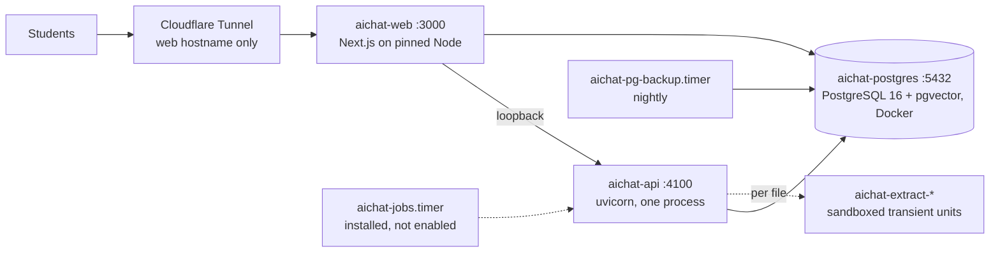

# Operations: observability, performance and failure recovery

> Verified at commit `0e33ec0` (2026-10-26) against `deploy/`, `backend/app/health.py`, `backend/app/logging.py`,
> `frontend/apps/app/src/app/api/health/route.ts` and the services' code.
>
> **How to deploy, check and roll back** is in [deployment.md](deployment.md) and [rollback.md](rollback.md); this
> page doesn't repeat those procedures or host access details. Every production action follows the owner's rules
> in [CLAUDE.md](../CLAUDE.md): changes need the owner's approval, and nothing is edited by hand on the host.

## Contents

- [What runs in production](#what-runs-in-production)
- [Is it healthy?](#is-it-healthy)
- [Logs and what they contain](#logs-and-what-they-contain)
- [Performance](#performance)
- [Backups and restore](#backups-and-restore)
- [Runbooks](#runbooks)

## What runs in production

One Ubuntu host, supervised by systemd, serving one checkout of `main` (`/opt/aichat/app`):

| Unit | What |
|---|---|
| `aichat-web.service` | The web app (BFF and Better Auth) |
| `aichat-api.service` | The API, one process, `MemoryMax=900M` |
| `aichat-postgres.service` | PostgreSQL in its pinned Compose project, the only container |
| `aichat-pg-backup.timer` | Nightly `pg_dump`; the same service runs before every migration |
| `aichat-jobs.timer` | The jobs worker, every minute when enabled (it isn't, today) |
| `aichat-deploy-*`, `aichat-extract-*` | Transient units: one deploy at a time; one file read each |

The layout and limits are listed in [INFRASTRUCTURE.md](../INFRASTRUCTURE.md).

## Is it healthy?

| Check | What it tells you |
|---|---|
| `bun run status` (from a workstation) | GitHub `main` against production, the commit each part runs, service health, CI's verdict, and whether a legacy port is listening. It must say `Status: MATCH` |
| `bun run smoke` | The live site as a student uses it (PASS or FAIL per check) |
| API `GET /health` | `{"status": "ok", "release", "files"}`: the process is up, the commit it started from, and whether files work |
| API `GET /ready` | The database is reachable (503 when not) |
| Web `GET /api/health` | The web server is up. For a local caller it also gives the release and whether sign-in reaches its database |
| `deploy/infra-check.sh` (on the host) | Ports, the API docs hidden, free disk (uploads stop under 5 GB), Tesseract languages, backup retention, files available |

**`MATCH`** means both parts run the production checkout's code. A part a commit didn't change keeps running an
older commit with identical code, which is still `MATCH`.

## Logs and what they contain

- **Format:** the API and the jobs worker log JSON lines (`app/logging.py`), each with a request id (from
  `X-Request-ID`, or generated) and, when known, the user id. The web app logs to its service journal.
- **Never logged:** message, document or chunk text; keys; codes; raw IP addresses in anything user-facing.
  Provider errors have key-like strings redacted.
- **Useful events:**
  - the access log line per request;
  - `rag.retrieval` and `rag.graph` (status, reason, timings);
  - generation outcomes, with replies slower than 20 s to the first token or 120 s in total logged as warnings;
  - the file worker's processing results;
  - `auth retention`;
  - classifier and voice timings;
  - `started` (environment, LLM, knowledge source, JEV and voice state).
- **Where:** `journalctl -u aichat-api` and `-u aichat-web`, and `journalctl -u 'aichat-deploy-*'` for deploys
  ([deployment.md, "Check production"](deployment.md#check-production)).
- **Errors in browsers:** reported only if a Sentry-compatible DSN is set (`NEXT_PUBLIC_SENTRY_DSN`).
  `self-hosted/glitchtip/` describes an optional self-hosted collector; it is not deployed.
- **No metrics or tracing system exists.** Usage, latency and tokens per reply are in `usage_events`, and each
  reply's retrieval, intent and scope in `messages.metadata`.

## Performance

Where a reply's time goes, in order:
1. JEV classification, when on, capped by `INTENT_ROUTER_TIMEOUT_S` (1.5 s by default; 5 s in production, 2026-10-26). The knowledge search starts in
   parallel (`graph.prefetch`).
2. The knowledge search. The NCERT service's searches were measured at about 1.7 s typical, p95 2.8 s and at most
   3.9 s (2026-10-15 to 10-19, [rag.md](rag.md)), against a 6 s timeout.
3. The model's first token, then the stream.

Measure it from the logs and `usage_events` rather than assuming; these are dated measurements, not guarantees.

On the web side:
- the reply renderer is a lazy chunk of about 170 kB gzipped, preloaded when the chat mounts;
- tokens are batched (about 50 ms), so only the streaming message re-renders;
- a reply is parsed block by block, and only the last block is re-parsed while it streams;
- heavy widgets (mermaid, charts, diagrams, the calendar) load on demand.

## Backups and restore

- **Nightly** `pg_dump` to the backup directory with `KEEP_DAYS` retention (7), plus one **before every
  migration**. The backup refuses to run with less than twice the database's size free.
- Dumps contain PadhAI's own data. They leave out (`deploy/backup.sh`):
  - the rows of `file_chunks`, rebuilt from the stored files after a restore;
  - the rows of `auth_sessions` and `auth_verifications` (live session tokens and sign-in codes), so everyone signs
    in again after a restore;
  - the separate NCERT service's schema (that service's own data and backups).
- **Restoring** is a deliberate, owner-approved operation: [rollback.md, "The database"](rollback.md#the-database).
  Never `docker compose down -v`: it deletes the database volume.

## Runbooks

Each row starts from what you see. **Production changes need the owner's approval**; reading logs and running
`bun run status` don't.

| You see | Check | Likely cause and fix |
|---|---|---|
| `Status: MISMATCH` | `bun run status` | Production isn't `main`: after a rollback, or a push not yet deployed. Deploy `main`, or roll back on purpose |
| A deploy stopped with `STOP:` | The printed reason; `journalctl -u 'aichat-deploy-*'` | What didn't restart keeps serving, and the next deploy redoes what didn't finish. Fix the cause, then deploy again ([deployment.md, "When a deploy fails"](deployment.md#when-a-deploy-fails)) |
| The site answers, but every page shows the outage screen | `/ready`; `journalctl -u aichat-api` | The API is down or can't reach PostgreSQL. Check the database unit, then the API's log. A bad release: `bun run rollback` |
| Replies fail with `llm_unavailable` or `llm_timeout` | The API log's generation errors; the provider's status | The provider (Ollima) is down or the key is exhausted. With `LLM_FALLBACK_MODEL` set, OpenRouter takes over before the first token |
| Files stay `failed` with `embedding_failed` | The file worker's log | The embeddings provider refused (for example, out of credits). Fix the provider, then Retry the files |
| Files `failed` with `extractor_failed`, or `/health` says `files: unavailable` | `python scripts/sandbox_probe.py` on the host; `journalctl -u aichat-api` (the files self-test) | The sandbox can't start (systemd and its permissions) or Tesseract is missing |
| Answers lack textbook context; `rag.retrieval` shows `ncert_*` reasons | `ncert_timeout`, `ncert_unauthorized`, `ncert_unavailable` | The NCERT service (a separate service) is slow, down, or the key is wrong. Replies still work without it |
| Sign-in codes don't arrive | The API log's `auth email failed` (`email_kind`) | The email backend (SMTP or Ollastack) refuses, or `AUTH_INTERNAL_TOKEN` differs between `api.env` and `web.env` |
| Reminder emails never arrive | `JOBS_ENABLED`, `NOTIFICATIONS_MODE` | The jobs worker is off by design until the owner enables it ([deployment.md, "Jobs worker"](deployment.md#jobs-worker)) |
| Uploads refused with `files_capacity_reached` | `deploy/infra-check.sh` (free disk) | The disk has under 5 GB free, or PadhAI's own tables have reached 3 GiB (`app/files/service.py`, `check_capacity`). Free space or grow the disk; raising the ceiling is a code change |
| A red CI job | `bun run status` | CI is advisory. See [testing.md, "Known baseline"](testing.md#known-baseline) before assuming it's new |
