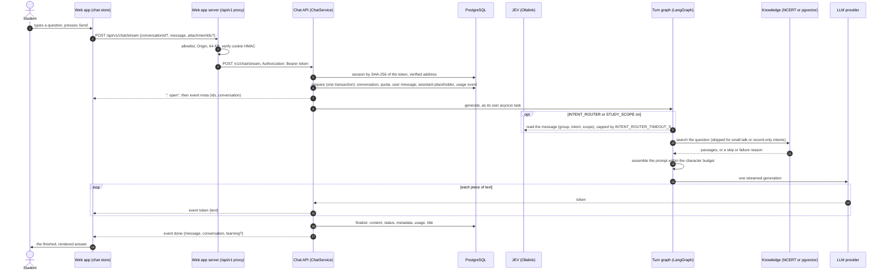
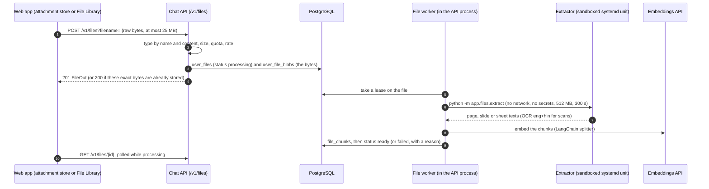
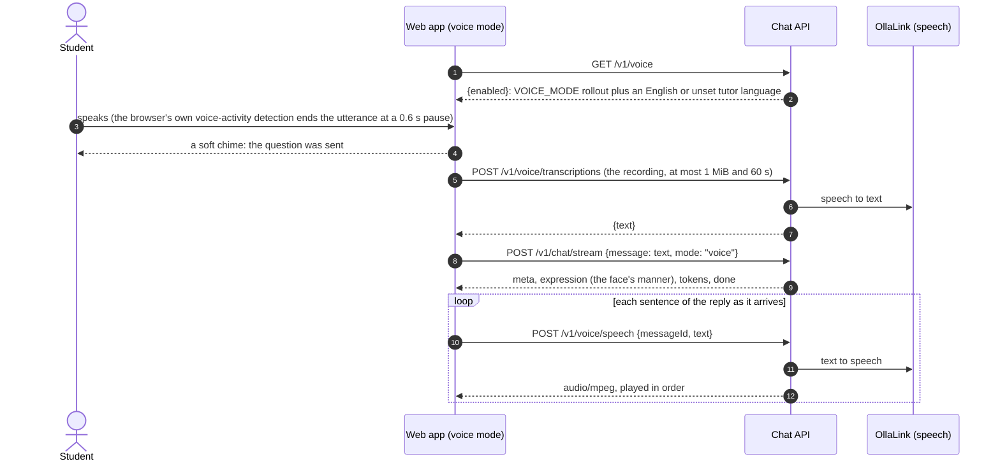

# Request lifecycle

> Verified at commit `0e33ec0` (2026-10-26) against `frontend/apps/app/src/features/chat/chat-store.ts`,
> `src/lib/api/chat.ts`, `src/lib/server/proxy-core.ts`, `backend/app/chat/service.py`, `streams.py`,
> `backend/app/rag/graph.py`, `backend/app/files/processing.py` and `backend/app/voice/`.

This page follows one chat message from the student's Send button to the finished answer on screen, then the
branches that differ: stop, regenerate, a practice-test answer, a file upload and voice. The architecture
overview is [architecture.md](architecture.md); the API shapes are in [api-contract.md](api-contract.md).

## Contents

- [The main path: one question, one streamed answer](#the-main-path-one-question-one-streamed-answer)
- [Step by step](#step-by-step)
- [Branches](#branches)
- [A file from upload to "ready"](#a-file-from-upload-to-ready)
- [A voice turn](#a-voice-turn)
- [Where a turn can fail, and what the student sees](#where-a-turn-can-fail-and-what-the-student-sees)

## The main path: one question, one streamed answer

## Step by step

1. **The browser sends only what is new** (`features/chat/chat-store.ts`): `{conversationId?, message,
   attachmentIds?}`. That's never the history and never a user id. A chat that has no id yet is a `draft:n` key
   until `meta` brings its real id.
2. **The proxy** (`lib/server/proxy-core.ts`):
   - checks the allowlist entry `POST /v1/chat/stream`, the `Origin` and the body size;
   - verifies the session cookie's HMAC;
   - forwards the request with `Authorization: Bearer`, an `X-Request-ID` and the client IP from
     `cf-connecting-ip`.
   - It passes the response stream through unbuffered.
3. **Authentication** (`app/auth/dependencies.py`): the API finds the session by the SHA-256 of its token and
   requires a verified address. Otherwise it answers 401 or 403.
4. **Prepare**, in one transaction (`ChatService.prepare_message`):
   - load or create the conversation, owned by the student and row-locked;
   - mark replies stuck in `streaming` as interrupted, and refuse with **409** if one is genuinely live;
   - check the reply quota against `usage_events` (**429**);
   - check the attached files (owned and `ready`, else **422**);
   - insert the user message, the attachments, an assistant placeholder (`streaming`) and a usage event;
   - count the question for today and read the student's learning context;
   - commit.
5. **`meta` goes out at once**: the conversation, the stored user message and the reply's id. The web app gives a
   new chat its URL here, without remounting the view, so the stream continues.
6. **Generate** runs as an independent task (`app/chat/streams.py` registry), so the reply is saved even if the
   student leaves. These steps happen inside it:
   - **JEV** (when on): Ollalink reads the message's group and intent, and the study scope, in short requests
     capped together and never retried. A failure is simply no reading. A clearly unrelated request (scope
     `REDIRECT`) gets the app's own reply, with no model call at all.
   - **Prompt** (`app/chat/assistant.py`):
     - the frozen system prompt;
     - then, each only when it says something: the scope policy, the teaching defaults, the student's settings,
       the voice line, the intent's guidance, the question bank's chapters, and the chat's practice record.
   - **Retrieval** (`app/rag/graph.py`, `receive_query → retrieve_context → assemble_context`):
     - the knowledge search starts while JEV is still reading (`graph.prefetch`), and is used only if the intent
       keeps search on;
     - small talk that opens a chat searches nothing, and a short follow-up is searched together with the
       question before it;
     - a failure never fails the turn: it is recorded with a reason code.
   - **Context budget** (`app/rag/context.py`): the system prompt, then the latest message, then whole passages up
     to `RAG_MAX_CONTEXT_CHARS`, then earlier messages up to `LLM_MAX_INPUT_CHARS`.
   - **One model call** (`generate_answer`): the fallback provider is tried only before the first token, and
     there are no retries.
7. **Tokens stream** as `event: token`. The web app batches them (about 50 ms) and re-renders only the streaming
   message.
8. **Finalize** (`ChatService._finalize`):
   - save the content, the status and the metadata (citations, any practice test, the internal retrieval summary,
     intent and scope);
   - update the usage event;
   - name a new chat once (at most six words);
   - record the learning day.
   - Then `done` carries the final message, and `learning` when this answer made today a learning day, which the
     web app celebrates.
9. **The web app renders** the Markdown safely (`features/markdown/`: sanitise, then KaTeX and highlighting, then
   widgets), and refreshes the streak and the bell.

## Branches

| Branch | What differs |
|---|---|
| **Stop** | The web app calls `POST /v1/messages/{id}/cancel`, reads until `done` (at most about 3 s), then aborts. The API cancels the graph task, which closes the model stream, and saves the partial text as `cancelled`. Closing the connection does the same. A database flag lets a stop work from another tab or process (`STREAM_CANCEL_POLL_S`) |
| **Regenerate** | `POST /v1/conversations/{id}/regenerate/stream`: the last reply becomes `superseded` (hidden, kept for feedback analysis) and a new one streams. Its question isn't counted again for today, and it reuses the turn's intent and scope |
| **Scope redirect** | With `STUDY_SCOPE=on` and a confident "unrelated" reading, the reply is the app's fixed redirect text: no model, no search, no learning day, no title. Never in a chat that holds a test or exercise |
| **A test in the chat** | When the student asks to be tested, the tutor names chapters in a question-bank block. Before the reply is saved, the server replaces it with a quiz of stored questions ([question_bank.md](question_bank.md)) |
| **Answering a test question** | `POST /v1/messages/{id}/assessment-responses`. The database grades it and the ledger records it; an adaptive test chooses the next question in the same transaction. Every 5th answer of an India day counts as a fully answered question, and `learning` reports a new learning day |
| **Attached files** | The conversation's ready attachments are read exactly, per file, and given to the model inside the student's own message, as reference material ([rag.md](rag.md), "Files the student attached") |
| **`POST /v1/chat`** | The same turn, answered whole instead of streamed (not used by the web app) |

## A file from upload to "ready"

A restart or deploy loses nothing: the lease is in PostgreSQL, and the worker picks the file up again. A failure
that a retry can fix (`embedding_failed`, `extractor_failed` and the like) offers Retry.

## A voice turn

A voice message is an ordinary chat message in every other way: quotas, scope, intents, search, the learning day
and the title. Nothing of the audio is stored.

## Where a turn can fail, and what the student sees

| Where | What happens |
|---|---|
| Proxy | 401 sends the page through `/api/session/expired`. An unreachable API shows the outage screen, never a sign-out |
| Prepare | 409 (a reply already streaming), 429 (quota), 422 (an unready attachment): the web app shows its own text per code, with one recovery action |
| JEV | No reading: the tutor answers as without the router. Never an error |
| Retrieval | Skipped or failed, with a reason code. The answer comes without that context |
| Model | An `error` event (`llm_unavailable`, `llm_timeout`, `llm_bad_request`) with `retryable`. The partial text is kept and the reply's status is `error` |
| Connection lost | The web app never re-sends. It re-reads the conversation, where the server has either finished the reply or recorded how it ended |
