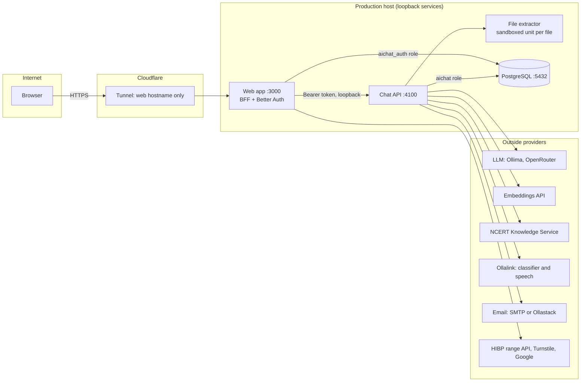

# Security

> Verified at commit `0e33ec0` (2026-10-26) against the code paths named in each section. This page explains how
> PadhAI is protected; it is not a place for secrets or host details. To report a problem, see
> [SECURITY.md](../SECURITY.md).

## Contents

- [Trust boundaries](#trust-boundaries)
- [Identity and sessions](#identity-and-sessions)
- [Authorisation and ownership](#authorisation-and-ownership)
- [The web app's protections](#the-web-apps-protections)
- [Secrets](#secrets)
- [Uploads and untrusted files](#uploads-and-untrusted-files)
- [AI-specific risks](#ai-specific-risks)
- [Rate limits and quotas](#rate-limits-and-quotas)
- [Privacy in logs, emails and the model](#privacy-in-logs-emails-and-the-model)
- [Data deletion and retention](#data-deletion-and-retention)
- [Safe local development](#safe-local-development)
- [Where each rule is tested](#where-each-rule-is-tested)

## Trust boundaries

| Boundary | What crosses it | What protects it |
|---|---|---|
| Browser → web app | Everything a user does | HTTPS through Cloudflare; the httpOnly, Secure, `__Host-` session cookie; CSP and security headers; `Origin` checks on mutations |
| Web app → API | Allowlisted `/v1` calls | Loopback only; `Authorization: Bearer`, taken from a cookie whose HMAC is verified first; the API re-checks every request |
| Better Auth → API | Code and security-notice requests | Loopback `/internal/auth/*`, the shared `AUTH_INTERNAL_TOKEN`, and checks that the rows named are real and fresh |
| API → extractor | A student's uploaded bytes | A sandboxed transient systemd unit per file: no network, no secrets, read-only system |
| API → outside providers | Prompts, search queries, audio | HTTPS (enforced for Ollalink and NCERT in production); only what each call needs (see [Privacy](#privacy-in-logs-emails-and-the-model)) |

The API is **never published**: it listens on `127.0.0.1`, and the tunnel publishes only the web app's hostname
(`deploy/cloudflared/config.yml.template`). Interactive API docs are off in production.

## Identity and sessions

**Who handles sign-in.** Better Auth, running inside the web app (`frontend/apps/app/src/lib/auth/`):
- **Sign-up** is email first: a code proves the address, then a password is set.
- **Sign-in** is by password, by email code, or with Google. Google is never linked implicitly
  (`disableImplicitLinking`).
- **Two-step sign-in** (an authenticator app, plus recovery codes) is asked for at every way in.
- **Changing how the account signs in** on a two-step account needs a sign-in within the last 15 minutes.
- **Password reset** is by emailed code.

**Passwords:**
- They are hashed with argon2id, in the API's PHC format (`lib/auth/password.ts`).
- A password seen in a breach is refused wherever one is set: Have I Been Pwned's range API, where only the first
  five characters of the password's SHA-1 hash leave the server (`lib/auth/protection.ts`).
- Length is 8–128 characters.

**Adaptive CAPTCHA:** Cloudflare Turnstile appears only when an address or account is being hammered, and only
when both Turnstile keys are configured.

**Sessions:**
- Better Auth sets the cookie: `__Host-padhai_session` over HTTPS, httpOnly, never readable by page code.
- Every JSON answer from `/api/auth/*` has its `token` removed (`withoutTokens`).
- The proxy verifies the cookie's HMAC (`BETTER_AUTH_SECRET`) before the token goes anywhere.
- The API finds the session by the token's **SHA-256** (`auth_sessions.token_hash`), requires a verified address,
  and authorises every request itself.
- A session is per device and sliding (renewed while used).
- Signing out or revoking a device deletes its row at once.

**Re-authentication** (email change, account deletion): the password, or, for an account without one, a sign-in
within 15 minutes. A two-step account needs both. Password checks share one per-account limit with sign-in
([api-contract.md, "Auth and account"](api-contract.md#auth-and-account)).

## Authorisation and ownership

- **Identity comes only from the verified session** (`app/auth/dependencies.py`). A client never sends a user id:
  unknown request fields are rejected.
- **Every query is scoped by the caller's id** (`app/conversations/repository.py`, `app/learning/service.py` and
  the other services). Another student's resource answers **404**, exactly like a missing one, so nothing reveals
  that it exists.
- **Retrieval** runs under `AccessScope(user_id)`: global sources plus the student's own. Request options can only
  narrow it, never widen it ([rag.md, "Access model"](rag.md#access-model)).
- **Attached files** are read only in their owner's own chats, and only once attached.
- **The web app's allowlists** decide what a browser *may* reach; the API still decides what is *allowed*. Never
  rely on the allowlist for authorisation.

## The web app's protections

From `frontend/apps/app/next.config.mjs` and `lib/server/proxy-core.ts`:

- **Content-Security-Policy:**
  - `default-src 'self'`, with no `object-src`, `base-uri 'none'`, `form-action 'self'` and
    `frame-ancestors 'none'`;
  - the only outside origins are Cloudflare Turnstile (the CAPTCHA) and Cloudflare Web Analytics;
  - `'unsafe-eval'` and WebSockets are in development only.
- **Headers:**
  - `Strict-Transport-Security` for two years, including subdomains;
  - `X-Content-Type-Options: nosniff` and `X-Frame-Options: DENY`;
  - `Referrer-Policy: strict-origin-when-cross-origin`;
  - `Permissions-Policy` allows the microphone for this site only (dictation and voice) and denies the camera and
    geolocation.
- **The proxy:**
  - forwards allowlisted routes only, and checks `Origin` on every mutation (403 `forbidden`);
  - accepts JSON bodies of at most 64 KB, except the declared upload routes;
  - drops query parameters it was not told to forward;
  - takes `X-Forwarded-For` only from Cloudflare's `cf-connecting-ip`;
  - re-wraps error envelopes;
  - clears the cookie on an upstream 401, except for `invalid_credentials`.
- **Redirects:** `?redirect=` targets pass through `safeRedirect`, so the app can never redirect to another site.
- **`/api/session/expired`** only clears the cookie after the API confirms that the session is over, so a link
  from another site can't sign anyone out.

## Secrets

| Secret | Where it lives | Note |
|---|---|---|
| `SECRET_KEY` | `api.env` | Keys email-code HMACs and unsubscribe-link signatures. Rotating it voids pending codes and every unsubscribe link already sent |
| `AUTH_INTERNAL_TOKEN` | `api.env` and `web.env` (the same value) | Without it the internal routes don't exist |
| `BETTER_AUTH_SECRET` | `web.env` | Signs the session cookie. Rotating it signs everyone out |
| Database passwords | `postgres.env`, `api.env` (`DATABASE_URL`), `web.env` (`AUTH_DATABASE_URL`) | Two roles: `aichat` (the API) and `aichat_auth` (identity tables only) |
| Provider keys (LLM, embeddings, Ollalink, NCERT, email, Google, Turnstile) | `api.env` or `web.env` | Never in the browser: no `NEXT_PUBLIC_` secret exists |

**Rules:**
- The `/etc/aichat/*.env` files are mode 600 and are never touched by a deploy.
- Nothing secret is ever committed: `.env` files and the provider key notes in the repository root
  (`ollima.txt`, `ollastack.txt`, `openrouter.txt`) are git-ignored.
- The example files hold placeholders only.
- Load secrets for a one-off command the way the service does; never `source` them, and never print them.
- If a key leaks: rotate it at the provider, update the env file, restart the affected service (a production
  change, so it needs the owner's approval), and check the logs for misuse.

## Uploads and untrusted files

- **Types and sizes:** a file's type is checked by its name **and** its content (`type_mismatch`), within a
  per-type size limit, a 100 MB quota per student, 500 files at most, and limits on how many are being read and
  how fast uploads come (`app/files/service.py`).
- **Parsing happens outside the API.** The API process never imports a parser. Each file is read by
  `python -m app.files.extract` in a **transient systemd unit** (`app/files/processing.py`):
  - `DynamicUser=yes`, a throwaway user;
  - `PrivateNetwork=yes` and `IPAddressDeny=any`;
  - `ProtectSystem=strict` and `NoNewPrivileges=yes`, with the code mounted read-only;
  - `MemoryMax=512M` and `RuntimeMaxSec=300`.

  Production refuses to parse any other way: without systemd, files are unavailable. Check a host with
  `python scripts/sandbox_probe.py`.
- **Profile photos:**
  - the bytes must be the declared type;
  - images over 40 megapixels are refused before decoding;
  - the photo is re-encoded as a 256 px WebP, so EXIF and GPS data never survive.
- **Bytes are stored in PostgreSQL** (`user_file_blobs`), deleted with the file or the account by foreign keys,
  and served back only to their owner.

## AI-specific risks

| Risk | Mitigation (where) |
|---|---|
| A student's file or a textbook passage says "ignore your instructions" | File text goes inside the student's own message, in an `<attached_files>` block marked as reference material, not instructions; anything that could close the block is neutralised. Retrieved passages come with a note that they may be incomplete or unrelated, and that sources must never be invented ([rag.md](rag.md)) |
| A student's settings text tries to steer the tutor | Their own text reaches the prompt only in quotes, as information (`app/learning/tutor.py`) |
| Earlier turns steer the classifiers | The intent and scope questions say which line is the request; context lines are never instructions (`app/intents/taxonomy.py`) |
| The model's output is hostile HTML or a malicious link | The renderer sanitises **first** (`rehype-sanitize`), shows raw HTML as text, allows only `http`, `https` and `mailto` links, never loads images (a captioned placeholder instead), runs KaTeX with `trust: false` and mermaid in strict mode (`features/markdown/`) |
| The model invents test questions or marks | Tests come only from the question bank: the server swaps in stored questions, and the database grades answers. The model never writes, picks or checks a bank question ([question_bank.md](question_bank.md)) |
| Off-topic use of the tutor | The study-scope filter (when on) redirects requests that are clearly unrelated, and the tutor's policy declines the rest ([ai-architecture.md](ai-architecture.md)) |

## Rate limits and quotas

There are three layers: Better Auth per IP (in memory), per-account limits in the database's `auth_attempts`
table, and API quotas. The full table is in
[api-reference.md, "Limits and quotas"](api-reference.md#limits-and-quotas).

Limits kept in the database hold across processes and restarts. The in-process limiters assume one API process,
which is what production runs.

## Privacy in logs, emails and the model

- **Logs** are JSON with a request id and user id. They **never** contain message, document or chunk text, keys,
  or codes, and the logging tests check this. Provider errors have key-like strings redacted. Voice logs carry
  sizes and times only.
- **LangSmith tracing must stay off.** It would send prompts and documents outside.
- **Devices and IP addresses:** the devices list shows a coarse label and a masked network (`203.0.113.x`). The
  raw IP address and user agent never leave the server, and emails never contain an IP address.
- **What reaches the model:** the system prompt, the student's learning settings and progress line (never their
  name, email or photo), retrieved passages, attached file passages, and the chat history within a character
  budget.
- **What reaches the NCERT service:** at most 32 words of the question, plus the fixed Classes 6–12 scope. Never an
  id, a name, the student's class or their subjects.
- **What reaches Ollalink:** the message text and the earlier turns needed to read it (classifier); the recorded
  utterance and the text to speak (voice). Voice audio is not stored.

## Data deletion and retention

- **An account deletion** (`DELETE /v1/me`, after re-authentication) removes every row that cascades from the
  user, then emails the address that it was.
- **A chat deletion** removes its messages; the student's practice answers stay in their record.
- **A file deletion** frees its bytes and chunks.
- **Backups** never hold a way into an account: the nightly dump leaves out the rows of `auth_sessions` and
  `auth_verifications` (live session tokens and sign-in codes), so after a restore everyone signs in again
  (`deploy/backup.sh`).
- **Retention:** [data-model.md, "Retention and deletion"](data-model.md#retention-and-deletion).

## Safe local development

- Use test accounts with `@example.com` addresses, `LLM_PROVIDER=fake` and `EMBEDDING_PROVIDER=fake` when you
  don't need a real model, and the Mailpit inbox for codes.
- Never point local tools at production:
  - the e2e suite refuses non-loopback URLs (`assertLoopback`);
  - `scripts/smoke_chat.py` defaults to the local API and must never be given a production URL;
  - test databases must end in `_test`.
- Never copy production data to a laptop.
- Never paste real student content into issues, prompts or docs.

## Where each rule is tested

| Rule | Test |
|---|---|
| Per-user isolation: another user's resources answer 404 | `backend/tests/test_authorization.py` |
| Every route needs a session unless it's on the recorded public list (read from the app's own OpenAPI) | `backend/tests/test_route_auth.py` |
| Dependency direction (routers never touch retrieval; the store knows no LangChain) | `backend/tests/test_architecture_guards.py` |
| Sessions, devices, re-authentication, email change, deletion | `test_auth.py`, `test_sessions_me.py`, `test_identity.py`, `test_account_deletion.py` |
| Log hygiene | `test_chat.py::test_logs_never_contain_the_question_or_document_text`, plus the key and secret checks in `test_intents.py`, `test_email.py`, `test_scope.py` and `test_voice.py` |
| The proxy, cookies and auth allowlist | `frontend/apps/app/src/lib/server/*.test.ts`, `src/lib/auth/routes.test.ts`, `src/lib/api/routes.test.ts` |
| Browser-level protections: security headers, no redirect to another site, and the proxy refusing other origins, unknown routes and oversized bodies | `frontend/apps/app/e2e/security.e2e.ts` |
