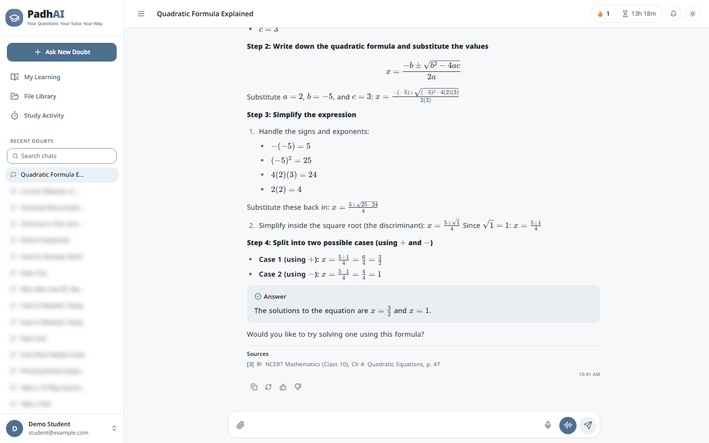
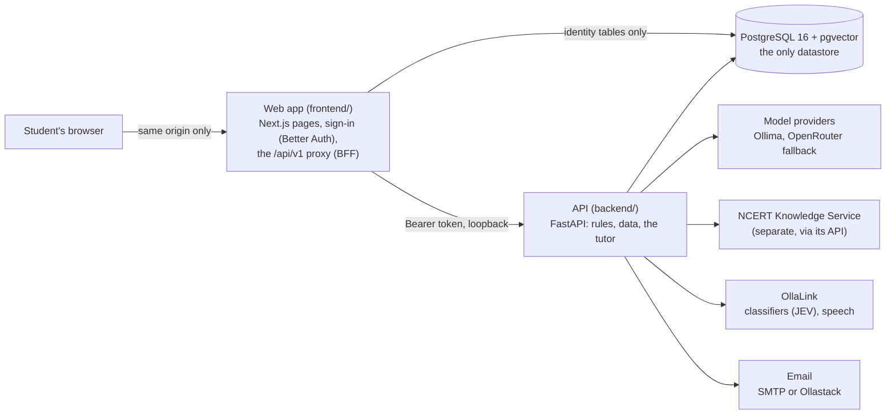

# Start here

> Verified at commit `0e33ec0` (2026-10-26).

Your first hour with PadhAI: what it is, how it fits together, and where to look next. The full list of documents
is in the [docs hub](README.md).

## What PadhAI is

PadhAI is an **AI tutor for school students in India** (Classes 6–12, CBSE and NCERT). A student asks a doubt in a
chat, and the tutor explains it step by step:
- with maths, chemistry, tables and diagrams;
- with citations to the NCERT textbook pages it used.

Around the chat:
- **Tests** from a bank of stored questions, never invented by the model, which adapt to each answer;
- **My Learning:** today's plan, revisions due, mastery and mistakes;
- **A learning streak** and **study time**;
- **The File Library:** students' own notes and worksheets, which the tutor can read;
- **Voice mode:** talk to the tutor in English;
- **Settings** that shape how the tutor teaches.

It runs on the web (desktop, tablet and phone) at one public address. The API is built so that native apps can
use it later. The full catalogue, with what is switched on in production, is in [features.md](features.md), with
[screenshots](screenshots/README.md).

## How it fits together

- **The browser only ever calls the web app.** Its server checks each request against an allowlist, adds the
  session token from an httpOnly cookie, and forwards it to the API. The token never reaches page code.
- **The API owns the data and the rules.** It checks every request's session and that the data belongs to that
  student, then answers. For a chat message, it streams the tutor's reply word by word (Server-Sent Events).
- **One repository, one release.** A commit of `main` is deployed to one server. Only the part it changed (the API,
  the web app or neither) is rebuilt and restarted.

[architecture.md](architecture.md) is the reference for all of this. [request-lifecycle.md](request-lifecycle.md)
follows one message all the way through.

## The repository

| Folder | What it holds |
|---|---|
| `backend/` | The API: FastAPI, SQLAlchemy and Alembic, LangGraph, the tests (`backend/tests/`) and scripts |
| `frontend/` | The web app: a Bun + Turborepo workspace. `apps/app` (Next.js), `packages/ui` (shared components), `tooling/typescript` |
| `docs/` | These documents, and the API contract `openapi.json` |
| `deploy/` | Production: the deploy, status and rollback scripts, the systemd units and the env templates |
| `scripts/run.mjs` | The task runner behind `bun run setup`, `dev`, `test`, `lint`, `build` and `contract` |
| `qbank/` | The question bank's source content, imported with `backend/scripts/import_questions.py` |
| `self-hosted/` | An optional error collector (GlitchTip), described but not deployed |

Every module, with what it does: [codebase-map.md](codebase-map.md).

## Your first hour

| Minutes | Do | Read |
|---|---|---|
| 0–10 | Read this page and skim the features | [features.md](features.md), [glossary.md](glossary.md) |
| 10–40 | Run it on your computer with the fake model | [beginner-guide.md](beginner-guide.md) |
| 40–50 | Follow one message from the browser to the database and back | [request-lifecycle.md](request-lifecycle.md) |
| 50–60 | Learn the rules for changing anything | [CLAUDE.md](../CLAUDE.md), [CONTRIBUTING.md](../CONTRIBUTING.md) |

## Rules to know before you change anything

- **Production changes need the owner's approval.** Nothing is edited by hand on the server; changes reach it only
  through `bun run deploy` from GitHub `main`.
- **Never commit or print secrets.** The settings files (`backend/.env`, `frontend/apps/app/.env.local`) and the
  root key files are git-ignored. The rules are in [security.md](security.md).
- **The API enforces the rules.** The web app may mirror a rule for a better experience, but the API checks it.
- **`/v1` only grows.** A breaking change needs a new endpoint ([api-contract.md](api-contract.md)).
- **Make the smallest safe change**, then run the checks
  ([CLAUDE.md](../CLAUDE.md), "The owner's hard rules").

## Next, by role

- **Building features:** [adding-a-feature.md](adding-a-feature.md), [frontend-architecture.md](frontend-architecture.md),
  [backend-architecture.md](backend-architecture.md), [api-reference.md](api-reference.md).
- **Working on the tutor:** [ai-architecture.md](ai-architecture.md), [rag.md](rag.md),
  [question_bank.md](question_bank.md).
- **Running production:** [deployment.md](deployment.md), [operations.md](operations.md),
  [rollback.md](rollback.md).
- **Stuck:** [troubleshooting.md](troubleshooting.md).
